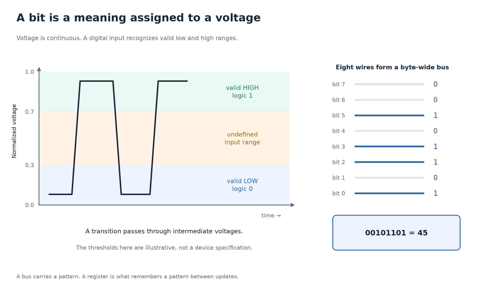
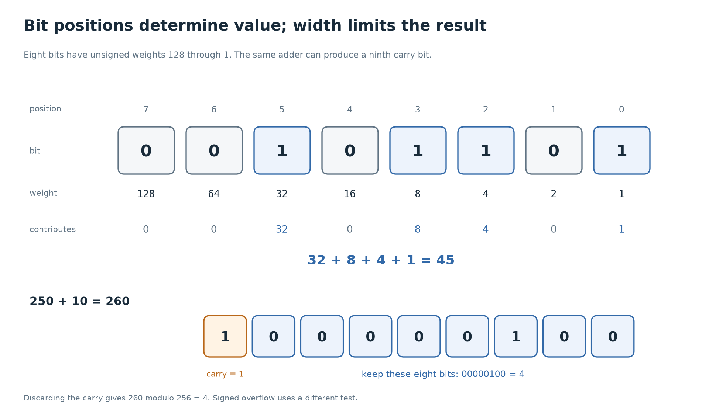

# 1. Bits, signals, and numbers

[Foundations](../README.md) · [Next: gates and Boolean logic →](02-gates-and-boolean-logic.md)

The first job is to connect a number on the page to something a circuit can carry. By the end of this chapter, an eight-bit wire bundle and a line such as `logic [7:0] value` should mean something concrete.

## A bit is an interpretation of a physical signal

A wire in a chip has a voltage. Digital circuits treat an allowed range of low voltages as **0**, and an allowed range of high voltages as **1**. A **bit** is one of those two logical values.

The voltage itself is continuous. A wire changing from low to high passes through intermediate voltages; the digital abstraction does not mean nature permits only two voltages. It means the circuit is designed to produce and recognize two dependable ranges. The exact thresholds depend on the technology and operating conditions, so “1 means one volt” is not a general rule.

Why ranges? A little electrical noise should not turn a 0 into a 1. Designers leave a **noise margin** between the levels a gate promises to produce and the levels the next gate promises to recognize. The region between valid low and valid high input levels is not a dependable third value.

A **transistor** is an electrically controlled device. In a simplified digital model, its gate voltage controls whether a conducting path is on or off. **CMOS** circuits combine n-channel and p-channel transistors into networks that pull an output toward the low or high supply rail. For example, a CMOS inverter produces a high output for a low input and a low output for a high input. We use these networks as logic gates in the next chapter.

This model deliberately leaves out transistor sizing, capacitance, leakage, and power distribution. Those matter when building a physical chip. For writing the first RTL, the useful boundary is: gates transform logic values, but their physical outputs take time to change.

## One wire, several wires, and a stored value



In the voltage panel, notice the intermediate voltages during a transition.
The logic value is an interpretation under the interface's voltage and
timing rules. In the bus panel, read the eight bit positions together;
one bit does not carry the whole byte.

A signal can carry a single bit. A **bus** is a group of signals treated together. An eight-bit bus can carry one of 256 bit patterns.

```systemverilog
logic       ready;     // one logic value
logic [7:0] value;     // eight logic values, indexed 7 down to 0
```

`value[0]` is the least significant bit in the number convention used here. `value[7]` is the most significant bit. The notation names the bits; it does not mean that the physical wires must be laid out left to right on a chip.

Declaring `logic` does **not** create a storage register by itself. How a signal is driven determines its role. A signal driven by combinational logic can change as its inputs change. A flip-flop can hold a value between clock edges. Chapter 4 will build that distinction.

SystemVerilog simulation also has `x` for unknown and `z` for high impedance, in addition to 0 and 1. These are modeling values, not additional binary digits you can use to count. An uninitialized register may appear as `x`; an undriven shared wire may appear as `z`. Physical circuits still have voltages, and an unknown simulation value does not describe a particular voltage.

## Binary is ordinary place value with powers of two

In decimal, `305` means `3 × 100 + 0 × 10 + 5 × 1`. In binary, each position has twice the weight of the position to its right.

| Bit position | 7 | 6 | 5 | 4 | 3 | 2 | 1 | 0 |
| --- | --- | --- | --- | --- | --- | --- | --- | --- |
| Unsigned weight | 128 | 64 | 32 | 16 | 8 | 4 | 2 | 1 |
| Example bit | 0 | 0 | 1 | 0 | 1 | 1 | 0 | 1 |

That pattern is `32 + 8 + 4 + 1 = 45`. The leading zeroes do not change its numeric value, but keeping eight positions tells us the width of the signal.

With **n** bits there are `2^n` different patterns. Under an **unsigned** interpretation, they represent integers from 0 through `2^n − 1`.

| Width | Number of patterns | Unsigned range |
| --- | --- | --- |
| 1 bit | 2 | 0 to 1 |
| 4 bits | 16 | 0 to 15 |
| 8 bits | 256 | 0 to 255 |
| 16 bits | 65,536 | 0 to 65,535 |

A **byte** is eight bits. A byte is a unit of data; an address identifies a location. In Tiny8, an eight-bit address selects one of 256 byte locations. An address of 45 and a stored byte with value 45 have the same bit pattern but different jobs.

## Hexadecimal makes bit patterns easier to read

Writing long binary strings becomes tiring. **Hexadecimal**, or hex, uses base 16: digits `0` through `9`, then `A` through `F` for 10 through 15. Each hex digit corresponds to exactly four bits.

| Decimal | Binary | Hex |
| --- | --- | --- |
| 0 | `0000` | `0` |
| 5 | `0101` | `5` |
| 10 | `1010` | `A` |
| 15 | `1111` | `F` |

Split `00101101` into `0010 1101`: the first group is 2 and the second is 13, written `D`. Therefore the byte is `2D` in hex. Its decimal value is `2 × 16 + 13 = 45`.

SystemVerilog can state width, base, and value explicitly:

```systemverilog
8'b0010_1101    // 8 bits, binary: 45
8'h2D          // 8 bits, hexadecimal: 45
8'd45          // 8 bits, decimal: 45
```

These are three spellings for the same eight-bit pattern. The underscore is a readability aid. Use explicitly sized literals while learning so that a number's width is visible. Unsized literals and mixed signed expressions have additional sizing rules.

## Negative integers use an agreed interpretation

The wires do not have a minus-sign wire. To represent signed integers, CPUs commonly use **two's complement**.

For an n-bit two's complement value, the top bit has weight `−2^(n−1)`; the other positions keep their positive weights. Eight-bit signed values therefore range from −128 to 127.

Take `11111101`:

```text
−128 + 64 + 32 + 16 + 8 + 4 + 0 + 1 = −3
```

An equivalent decoding shortcut is to interpret the pattern as unsigned first. If the top bit is 1, subtract `2^n`. Here the unsigned value is 253, and `253 − 256 = −3`.

To form −3 from +3 in eight bits:

1. Start with `00000011`.
2. Invert each bit: `11111100`.
3. Add 1: `11111101`.

The adder can use the same bit operations for unsigned and two's complement addition. The interpretation of the result, comparisons, extensions, and overflow detection still matters.

```systemverilog
logic        [7:0] unsigned_value;
logic signed [7:0] signed_value;
```

Both declarations have eight bits. If both hold `8'hFD`, the first represents 253 and the second represents −3. Tiny8's accumulator is declared without `signed`; it holds an eight-bit pattern and its arithmetic keeps the low eight result bits. Do not assume that a negative-looking pattern automatically makes an SV comparison signed.

## Fixed width means results can wrap

An eight-bit result cannot hold 260. When an addition is reduced to eight bits, it keeps the low eight bits:

```text
250 + 10 = 260
260 modulo 256 = 4
```

There is a ninth carry bit. If the design discards it, the stored byte is `04`. To preserve that carry in an unsigned addition, explicitly extend the inputs:

```systemverilog
logic [7:0] a, b;
logic [8:0] wide_sum;
assign wide_sum = {1'b0, a} + {1'b0, b};
```

Braces concatenate bits. Each operand above is nine bits wide, so the result can represent sums through 510. `wide_sum[8]` is the carry out; `wide_sum[7:0]` contains the low eight bits.

**Carry** and **signed overflow** answer different questions:

| Eight-bit addition | Stored bits | Unsigned interpretation | Signed interpretation |
| --- | --- | --- | --- |
| `FA + 0A` | `04` | `250 + 10` exceeds 255; carry out is 1. | `−6 + 10 = 4` fits; no signed overflow. |
| `7F + 01` | `80` | `127 + 1 = 128` fits; carry out is 0. | `127 + 1` exceeds 127; signed overflow. |

For signed addition, adding two operands with the same sign produces overflow if the stored result has the opposite sign. Tiny8 exposes a zero flag, not a carry or signed-overflow flag. Do not infer flags that its ISA does not define.

Subtraction wraps too. In eight bits, `0 − 1` produces `FF`. That is 255 under an unsigned interpretation and −1 under a two's complement interpretation.



The weights explain the numeric value; the receiving width explains which
bits survive. Follow the ninth bit separately from the eight stored bits.

## Widening must preserve the intended value

**Zero extension** adds zeroes on the left. **Sign extension** repeats the old sign bit on the left.

| Original four bits | Interpretation | Correct eight-bit extension |
| --- | --- | --- |
| `1101` | Unsigned 13 | `00001101`, still 13 |
| `1101` | Signed −3 | `11111101`, still −3 |

Zero-extending a negative signed value changes its meaning. Sign-extending an unsigned value with its top bit set changes its meaning too. When narrowing a value, high bits may be lost entirely. Always ask what width and interpretation the receiving circuit expects.

## Where this appears in Tiny8

Open [cpu_pkg.sv](../../verilong/cpu/src/cpu_pkg.sv). `8'h02` names an eight-bit pattern that the CPU interprets as `ADD_IMM`. There is nothing inherently “add-like” about that pattern; the decoder gives it that meaning.

Open [alu.sv](../../verilong/cpu/src/alu.sv). Its `a`, `b`, and `result` ports are eight-bit buses. The arithmetic must fit the result port, so the intended Tiny8 addition and subtraction wrap at eight bits. The file is a student exercise; its current contents are not the finished behavior described by the guide.

## Check your understanding

1. Why does an electrical signal have valid voltage ranges rather than a requirement to be exactly 0 V or exactly one particular high voltage?
2. What are the decimal values of `8'h3A` and `8'b0011_1010`?
3. What does `8'hFE` mean as an unsigned integer? What does it mean as two's complement?
4. An eight-bit adder stores the low bits of `255 + 2`. What is stored, and is the unsigned carry out 0 or 1?
5. How should signed four-bit `1011` be extended to eight bits? What decimal value does it represent?

<details>
<summary>Answers</summary>

1. Small noise and physical variations should leave the logical value unchanged. Gates promise to produce and recognize ranges, with noise margins between the relevant guarantees.
2. Both are 58: `3 × 16 + 10`, or `32 + 16 + 8 + 2`.
3. Unsigned 254; signed −2 because `254 − 256 = −2`.
4. `01`, or 1. The carry out is 1 because 257 needs a ninth bit.
5. `11111011`. The original pattern is −5; repeating its sign bit preserves that value.

</details>

[Next: gates and Boolean logic →](02-gates-and-boolean-logic.md)
