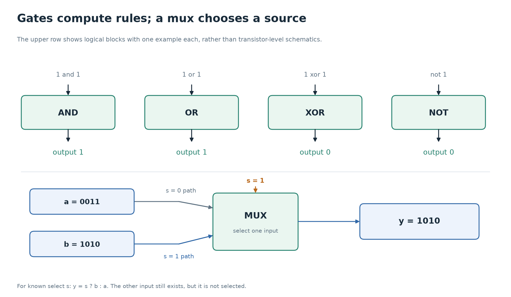

# 2. Gates and Boolean logic

[← Bits and signals](01-bits-and-signals.md) · [Foundations](../README.md) · [Next: combinational circuits →](03-combinational-circuits.md)

A bit gives us two possible values. A **logic gate** applies a rule to input bits and produces output bits. Connecting gates lets us calculate, compare, and choose values.

This chapter assumes inputs are known 0s or 1s. Unknown values in simulation have additional propagation rules; we return to their debugging implications when discussing RTL.

## A truth table specifies every input combination

For a gate with two one-bit inputs, there are four possible input combinations. A **truth table** lists the output for all four. Read each row as a separate situation, not as a sequence in time.

| `a` | `b` | AND | OR | XOR | NAND | NOR |
| --- | --- | --- | --- | --- | --- | --- |
| 0 | 0 | 0 | 0 | 0 | 1 | 1 |
| 0 | 1 | 0 | 1 | 1 | 1 | 0 |
| 1 | 0 | 0 | 1 | 1 | 1 | 0 |
| 1 | 1 | 1 | 1 | 0 | 0 | 0 |

- **AND** outputs 1 only when both inputs are 1.
- **OR** outputs 1 when at least one input is 1, including when both are 1.
- **XOR**, exclusive OR, outputs 1 when the two inputs differ.
- **NAND** is the inverse of AND.
- **NOR** is the inverse of OR.

**NOT**, or inversion, has one input:

| `a` | NOT `a` |
| --- | --- |
| 0 | 1 |
| 1 | 0 |

“Exclusive” in XOR matters. A permission rule that allows access when either of two approvals is present normally uses OR. If both approvals are present, access should still be allowed. XOR would turn the output off in that case.

## Translate a rule into a circuit



For each gate, ask which input combination makes its output 1. The selector
panel previews the mux in chapter 3: its control chooses which value to
pass, rather than combining the two values arithmetically.

Suppose a device should run when it is enabled and either a manual request or a scheduled request is present. Call the inputs `enable`, `manual`, and `scheduled`.

```systemverilog
assign run = enable & (manual | scheduled);
```

There is an OR gate for the two request inputs, followed by an AND gate with `enable`. The parentheses show which result feeds which gate. The expression describes a connection that remains present, not an instruction to check these signals once.

| `enable` | `manual` | `scheduled` | `run` |
| --- | --- | --- | --- |
| 0 | any known bit | any known bit | 0 |
| 1 | 0 | 0 | 0 |
| 1 | 0 | 1 | 1 |
| 1 | 1 | 0 | 1 |
| 1 | 1 | 1 | 1 |

An output with no stored state depends on its current inputs, after propagation delay. It cannot remember that a request was present yesterday. Remembering an event requires storage.

## Boolean algebra lets us change the circuit without changing its rule

**Boolean algebra** is algebra for values 0 and 1 with operations such as AND, OR, and NOT. It tells us when two expressions have the same truth table.

Here `~` means NOT, `&` means AND, and `|` means OR. For one-bit known inputs:

| Identity | Why it makes sense |
| --- | --- |
| `a & 1 = a` | AND with 1 leaves the other input in control. |
| `a & 0 = 0` | AND needs both inputs to be 1. |
| `a \| 0 = a` | OR with 0 leaves the other input in control. |
| `a \| 1 = 1` | OR already has a 1. |
| `a & a = a` | Repeating the same condition adds no requirement. |
| `a \| a = a` | Repeating the same option adds no possibility. |
| `~~a = a` | Two inversions restore the original bit. |
| `a & ~a = 0` | A known bit and its inverse cannot both be 1. |
| `a \| ~a = 1` | One of a known bit and its inverse must be 1. |

The equals signs in this table mean “has the same logical value as,” not assignment syntax.

**De Morgan's laws** move inversion across AND or OR:

```text
~(a & b) = (~a) | (~b)
~(a | b) = (~a) & (~b)
```

For the first identity: “it is not true that both are 1” means “at least one is 0.” For the second: “neither input is 1” means “both inputs are 0.” You can prove either identity by comparing all four truth-table rows.

Why learn this? Synthesis tools can rewrite equivalent logic into gates available in a target technology. Two expressions can compute the same result while differing in physical area, delay, or power. NAND gates alone are sufficient to construct arbitrary Boolean logic; for example, `NAND(a, a)` is NOT `a`. You do not need a separate physical gate type for every source-code operator.

## Bitwise operations apply the rule to each position

An eight-bit AND is eight one-bit AND operations in parallel. Position 0 combines with position 0, position 1 with position 1, and so on. No carry passes between positions.

| Operation | `a = 1100` | `b = 1010` | Result |
| --- | --- | --- | --- |
| `a & b` | `1100` | `1010` | `1000` |
| `a \| b` | `1100` | `1010` | `1110` |
| `a ^ b` | `1100` | `1010` | `0110` |
| `~a` | `1100` | unused | `0011` for a four-bit result |

One use of AND is a **mask**: each mask bit decides whether to keep a corresponding input bit. For a byte `10110110`, AND with `00001111` keeps only the low four bits and produces `00000110`.

OR with a mask sets selected bits to 1. XOR with a mask flips selected bits. AND with the inverse of a mask clears selected bits.

## Bitwise, logical, and reduction operators are different

SystemVerilog gives similar-looking operators different jobs:

| Kind | Example | Result for `a = 4'b1100`, `b = 4'b1010` |
| --- | --- | --- |
| Bitwise AND | `a & b` | Four-bit `1000` |
| Logical AND | `a && b` | One-bit `1`, because both operands are nonzero |
| Bitwise OR | `a \| b` | Four-bit `1110` |
| Logical OR | `a \|\| b` | One-bit `1`, because at least one operand is nonzero |
| Bitwise NOT | `~a` | Four-bit `0011` |
| Logical NOT | `!a` | One-bit `0`, because `a` is nonzero |
| Reduction AND | `&a` | One-bit `0`, because not every bit of `a` is 1 |
| Reduction OR | `\|a` | One-bit `1`, because at least one bit of `a` is 1 |
| Reduction XOR | `^a` | One-bit `0`, because `a` contains an even number of 1s |

The position and number of operands matter. In `a & b`, `&` combines two vectors bit by bit. In `&a`, it combines all bits of one vector into one result.

If an eight-bit ALU operation should produce the bitwise OR of two bytes, `||` computes a different function. It reduces each operand to a truth value and produces one result bit. Widening that bit into an eight-bit output cannot recover the seven missing bit results.

For one-bit known inputs, `&` and `&&` have the same truth table. That coincidence is why a mistaken logical operator can go unnoticed until a wider input is tested.

## Delay and glitches do not appear in the truth table

A truth table specifies a stable result for stable inputs. Real gates and wires take time to propagate a change. If two paths have different delays, an output can briefly have an unwanted value before settling. That brief change is a **glitch**.

For example, a signal and its inverted copy do not physically change at exactly the same instant. Even an expression that algebraically simplifies to a constant can have a transient in an unreduced physical implementation. Synthesis may remove such redundant logic, but Boolean equivalence by itself does not describe timing.

An ordinary zero-delay RTL simulation models the logical dependencies through scheduled simulator events; it does not establish the delay of a manufactured gate. Later, clocked registers give combinational paths a time budget in which to settle before sampling.

## Where this appears in Tiny8

The `AND_IMM` and `OR_IMM` instructions in [cpu_pkg.sv](../../verilong/cpu/src/cpu_pkg.sv) request bitwise operations on the accumulator and the immediate operand. [alu.sv](../../verilong/cpu/src/alu.sv) is where those operations belong. The opcode decoder also uses Boolean decisions, but its outputs are control signals rather than the arithmetic result.

## Check your understanding

1. When both inputs are 1, how do OR and XOR differ?
2. What is `8'b1010_1100 & 8'b0000_1111`?
3. For `a = 4'b1000` and `b = 4'b0010`, compare `a | b` with `a || b`.
4. Write “neither request is present” using a NOT around an OR, then using De Morgan's law.
5. Does a correct truth table prove that a physical output never glitches?

<details>
<summary>Answers</summary>

1. OR produces 1; XOR produces 0. XOR requires different input bits.
2. `00001100`, or 12. The mask clears the high four bits.
3. `a | b` is four-bit `1010`. `a || b` is one-bit `1`.
4. `~(request_a | request_b)` is equivalent to `(~request_a) & (~request_b)` for one-bit known inputs.
5. No. The table describes stable logical results. Physical path delays determine intermediate behavior.

</details>

[Next: combinational circuits →](03-combinational-circuits.md)
