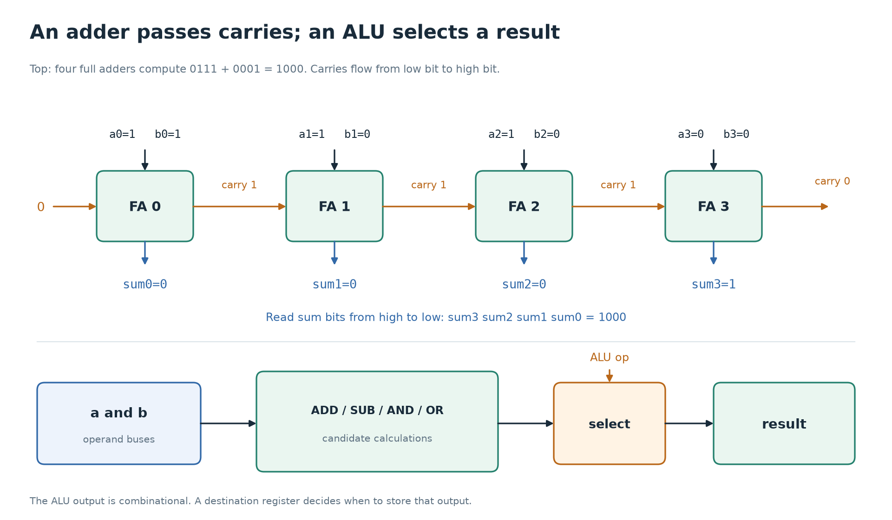

# 3. Combinational circuits: choosing, adding, and comparing

[← Gates and Boolean logic](02-gates-and-boolean-logic.md) · [Foundations](../README.md) · [Next: state and the clock →](04-state-and-clock.md)

Useful circuits are built by connecting small logical rules. In a **combinational circuit**, the outputs depend on the current inputs, with no stored history. After inputs stop changing and propagation finishes, the outputs settle to the values specified by the circuit's function.

This chapter builds the blocks that appear repeatedly in a CPU: multiplexers, decoders, adders, comparators, shifters, and the ALU.

## A multiplexer chooses which value goes through

A **multiplexer**, usually shortened to **mux**, selects one of several input values. A two-input mux has two data inputs and one select bit.

| Select `s` | Output `y` |
| --- | --- |
| 0 | `a` |
| 1 | `b` |

For one-bit inputs, the Boolean rule is:

```text
y = (~s & a) | (s & b)
```

When `s` is 0, the first AND passes `a` and the second contributes 0. When `s` is 1, the second AND passes `b` and the first contributes 0.

SystemVerilog has a compact spelling:

```systemverilog
logic [7:0] a, b, y;
logic s;
assign y = s ? b : a;
```

This is an eight-bit mux: all eight result bits choose the corresponding bit from the same selected input. `s ? b : a` means “if select is 1, choose b; otherwise choose a” for a known select bit.

Why is a mux so central to CPUs? A register often has several possible next values. The program counter might receive its old value plus one, a jump target, or its unchanged value. A mux selects the input before the register stores it. The mux makes the choice; the register provides the memory.

Tiny8 also needs an address mux. While fetching an instruction, memory should see PC. During a data load or store, it should see the operand address. Memory still has one address input; control chooses which source drives it.

## A decoder recognizes a pattern

A simple two-to-four **decoder** takes a two-bit input and asserts the corresponding one of four outputs:

| Input | `d0` | `d1` | `d2` | `d3` |
| --- | --- | --- | --- | --- |
| `00` | 1 | 0 | 0 | 0 |
| `01` | 0 | 1 | 0 | 0 |
| `10` | 0 | 0 | 1 | 0 |
| `11` | 0 | 0 | 0 | 1 |

For input bits `x1` and `x0`, the final output is `d3 = x1 & x0`; the first is `d0 = ~x1 & ~x0`. Exactly one output is 1 for a known input. This is a **one-hot** output.

A CPU **instruction decoder** applies the same idea to opcode patterns. Its interface does not have to be strictly one-hot. Tiny8's [decoder.sv](../../verilong/cpu/src/decoder.sv) produces facts such as `needs_operand`, `is_alu`, and `is_halt`, plus an ALU-operation selector. Several of those facts can be true together.

An **encoder** maps a selected input back to a compact code. If exactly one of four request inputs is asserted, a four-to-two encoder can report its index. If multiple requests may arrive together, a **priority encoder** needs an explicit rule, such as “highest index wins.” Without that rule, “encode the active request” is underspecified. An all-zero request also needs a convention, often a separate `valid` output.

## A half adder adds two bits

Adding one-bit values has four cases:

| `a` | `b` | Sum bit | Carry bit |
| --- | --- | --- | --- |
| 0 | 0 | 0 | 0 |
| 0 | 1 | 1 | 0 |
| 1 | 0 | 1 | 0 |
| 1 | 1 | 0 | 1 |

For `1 + 1 = 2`, binary 2 is `10`: sum bit 0, carry bit 1. The table reveals two familiar gates:

```text
sum   = a XOR b
carry = a AND b
```

This is a **half adder**. It cannot accept a carry arriving from a lower bit position.

## A full adder also accepts an incoming carry

A **full adder** has inputs `a`, `b`, and `carry_in`. Their total can be 0, 1, 2, or 3; two result bits are enough to represent it.

```text
sum       = a XOR b XOR carry_in
carry_out = (a AND b) OR (a AND carry_in) OR (b AND carry_in)
```

The sum is 1 when an odd number of inputs are 1. A carry is needed when at least two inputs are 1. For example, `1 + 0 + 1 = 2`, so the sum bit is 0 and the carry out is 1.

Connect the carry out of bit 0 to the carry input of bit 1, then continue upward, and you have a **ripple-carry adder**. The initial carry input is 0 for ordinary addition.

Work through four-bit `0111 + 0001`:

| Bit, from low to high | `a` bit | `b` bit | Carry in | Sum bit | Carry out |
| --- | --- | --- | --- | --- | --- |
| 0 | 1 | 1 | 0 | 0 | 1 |
| 1 | 1 | 0 | 1 | 0 | 1 |
| 2 | 1 | 0 | 1 | 0 | 1 |
| 3 | 0 | 0 | 1 | 1 | 0 |

Reading the sum from bit 3 down to bit 0 gives `1000`, or 8.

This example also explains delay. The high bit can depend on a carry produced at the low bit and propagated through intermediate stages. All gates exist at once, but dependent signals need time to travel through them. Faster adder designs compute carries with more parallel logic. In RTL, writing `a + b` generally lets synthesis choose an implementation suited to the target rather than forcing a ripple chain.



Follow the carry from the least significant position toward the most
significant one. The lower panel adds a second idea: several combinational
functions can have candidate results present while a selector chooses the
ALU's output.

## Subtraction can reuse addition

For a fixed-width result, subtracting `b` is equivalent to adding its two's complement:

```text
a − b = a + (~b) + 1, keeping the desired low result bits
```

For four-bit `5 − 3`:

```text
a             = 0101
b             = 0011
inverted b    = 1100
0101 + 1100 + 1 = 1 0010
low four bits = 0010 = 2
```

An add/subtract circuit can conditionally invert every bit of `b` and use that same control bit as the initial carry input. With control 0, it computes `a + b`. With control 1, it computes `a + ~b + 1`.

The final carry's interpretation in subtraction requires care. Some ISAs expose “borrow,” others “no borrow,” and some expose neither. Tiny8 defines a zero flag only. Its specification does not promise a carry or borrow output.

## Comparators produce a decision bit

A **comparator** answers a question about values. Equality can be built by checking each corresponding pair of bits and ANDing those match results. Equivalently, XOR reveals the positions that differ, and reduction OR asks whether any difference exists.

```systemverilog
logic [7:0] a, b;
logic equal;
assign equal = (a == b);
```

For known inputs this yields 1 if all eight positions match. With unknown inputs, ordinary `==` may yield `x`; tests must account for that separately.

Less-than comparison depends on numeric interpretation. The byte `FF` is greater than `01` as unsigned data (`255 > 1`), but less than `01` as signed two's complement (`−1 < 1`). A comparator needs the intended signedness, not just the same eight wires.

An **incrementer** is a specialized addition circuit that adds one. A PC uses it to move to the next byte. It is combinational logic; the PC register stores the resulting address on a clock edge.

## Shifts move the positions of bits

A left shift moves bits toward higher positions. A logical right shift moves them toward lower positions and fills from the left with zeroes. Bits shifted beyond the fixed width are discarded.

| Four-bit operation | Result | What happened |
| --- | --- | --- |
| `0011 << 1` | `0110` | 3 becomes 6. |
| `1011 << 1` | `0110` | The old top bit is discarded. |
| `1011 >> 1` | `0101` | A logical right shift fills with 0. |
| Signed arithmetic right shift of `1011` by 1 | `1101` | The sign bit is repeated; −5 becomes −3. |

A left shift by one corresponds to multiplication by two only when the intended interpretation and overflow are handled. An arithmetic right shift of a negative two's complement number rounds toward negative infinity, so it is not always the same as signed integer division that truncates toward zero.

SystemVerilog uses `<<` and `>>` for logical shifts. Arithmetic right shift uses `>>>` and requires a signed left operand to propagate the sign bit. Merely changing `>>` to `>>>` on an unsigned signal does not make it signed.

A fixed shift can often be implemented as wiring. A shift by a variable amount requires selection logic, commonly a **barrel shifter** assembled from mux stages. Tiny8's current ISA has no shift instruction; this is a building block for later extensions.

## An ALU combines calculations with selection

An **arithmetic logic unit**, or ALU, accepts operands and an operation selector. It produces the corresponding arithmetic or bitwise result. Tiny8's ALU selects among ADD, SUB, AND, and OR.

One useful mental picture is several candidate results feeding a mux. Actual synthesis may share circuitry, such as an adder for addition and subtraction, rather than literally building four independent full-size units.

The ALU has no reason to know the program counter or the instruction-fetch state. Its job is local: given these operands and this operation, produce this result. Control elsewhere decides whether the accumulator will store that result.

The **zero indication** asks whether every result bit is 0:

```systemverilog
assign result_is_zero = (result == 8'h00);
```

That is a combinational decision about the current result. Tiny8's `z_flag` is a different object: a register remembering whether the last value written to the accumulator was zero. A transient ALU result must not silently change the stored flag. In particular, loading a zero immediate into A should update Z even though the instruction did not need the ALU.

## Combinational means no remembered previous output

Suppose an output should choose `a` when enabled and zero otherwise:

```systemverilog
always_comb begin
  y = '0;
  if (enable)
    y = a;
end
```

The default assignment specifies the output even when `enable` is 0. If you omitted that default and gave no `else`, the desired behavior would implicitly become “keep the previous y” on the missing path. Keeping a previous value requires storage, often a latch. A combinational block must assign its outputs for every possible path.

Assignments inside this procedural block use blocking `=` and are evaluated in source order when the simulator executes the block. The resulting circuit still has no instruction pointer walking those assignments in time. Source order can express a priority among alternatives; it does not add a clock cycle per line.

## Where this appears in Tiny8

| Circuit idea | Place to look | Question to ask |
| --- | --- | --- |
| Operation selection | [alu.sv](../../verilong/cpu/src/alu.sv) | Which result should this selector choose? |
| Instruction recognition | [decoder.sv](../../verilong/cpu/src/decoder.sv) | What facts does this opcode imply? |
| Address selection | [cpu.sv](../../verilong/cpu/src/cpu.sv) | Does memory need PC or the operand address now? |
| Incrementing | [pc.sv](../../verilong/cpu/src/pc.sv) | Which value will feed the PC register? |

These files contain student TODOs. The table describes the intended circuits, not evidence that the current CPU already implements them.

## Check your understanding

1. A mux selects between byte `35` and byte `A0`, with select 1 choosing the second input. What appears at the output when select is 1? Does the mux remember the old selection?
2. Why does a full adder need a carry input when a half adder does not?
3. What four-bit result is stored for `1111 + 0001`? What is the carry out?
4. Why can the ALU's zero indication change while Tiny8's stored Z flag remains unchanged?
5. If an `always_comb` block assigns `y` only when `enable` is 1, what behavior is missing from the description?

<details>
<summary>Answers</summary>

1. `A0`. The mux has no stored history; a later select change chooses the other input after propagation.
2. A full adder must include a carry generated by a lower bit position. A half adder only adds its two local bits.
3. The low four bits are `0000`; the carry out is 1. Five bits would represent the full sum as `10000`.
4. The ALU is combinational. Z is stored state and updates only when the control logic deliberately writes the accumulator and flag.
5. The output value when `enable` is 0. Leaving it unspecified suggests retaining the old value, which requires storage rather than a purely combinational circuit.

</details>

[Next: state and the clock →](04-state-and-clock.md)
