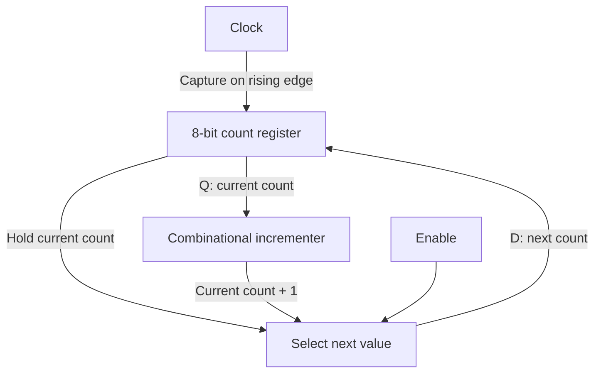
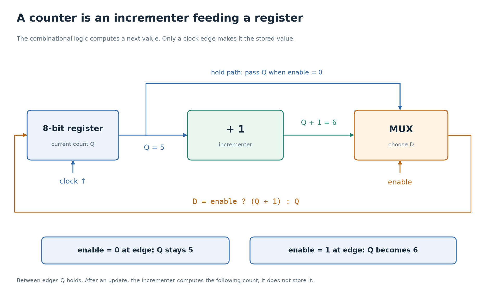
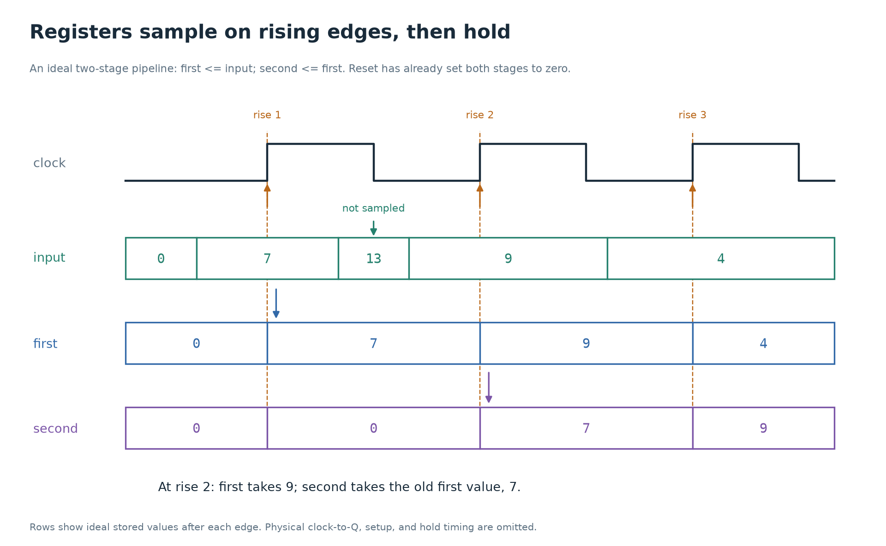

# 4. State, the clock, and time

[Foundations](../README.md) · [Previous: combinational circuits](03-combinational-circuits.md) · [Next: memory and buses](05-memory-and-buses.md)

A calculator circuit can produce `a + b` while those inputs are connected. A CPU also needs to remember the previous result, the next instruction address, and which step of an instruction it has reached. That remembered information is **state**.

By the end of this lesson, you should be able to follow a register through clock edges, explain why a clock has a speed limit, and read a small finite state machine.

## Storage changes what a circuit can do

For a combinational circuit, the present inputs determine the output. A sequential circuit also depends on state left by earlier inputs.

Imagine a lamp controlled by a push button. A purely combinational design might keep the lamp on only while the button is pressed. A design that toggles the lamp with each press needs to remember whether the lamp is already on. The same button input can produce different outcomes because the remembered state differs.

Feedback is the physical idea behind storage: a circuit can reinforce a previously established value. Practical storage cells use transistor circuits designed for this purpose. You do not construct their transistor networks in this project. You describe when their stored bits should change.

Two common storage elements have different rules:

| Element | When it accepts an input | When it holds the old value |
| --- | --- | --- |
| Level-sensitive latch | Throughout the interval when its enable is active | While its enable is inactive |
| Edge-triggered D flip-flop | Around its designated clock edge | Between those edges |

For a positive-edge-triggered flip-flop, **D** is the input to be sampled and **Q** is the stored output. The flip-flop accepts a value on the rising edge, when `clk` changes from 0 to 1. A real device needs the input stable for a small interval around that edge; we will return to this.

A **register** is a group of storage bits treated as one value. An 8-bit register is typically eight flip-flops sharing a clock. Not every stored array is built from flip-flops: larger memories use denser storage structures, covered in the [next lesson](05-memory-and-buses.md).

## Computing a next value and storing it are separate jobs

Consider an 8-bit register named `count`. Its output connects to an adder that computes `count + 1`. The adder output connects back to the register input. The register breaks what would otherwise be an uncontrolled combinational feedback loop: it holds a fixed output while the adder works.

At an edge, the register samples the computed next value. Its output then changes, so the adder starts computing the value for the following edge. This repeats.



Trace the feedback loop from the register through the incrementer and mux,
then back to the register. The register prevents a newly computed input
from becoming the output until an edge accepts it. The mux can instead
feed the current value back to hold the count.

```systemverilog
logic [7:0] count;

always_ff @(posedge clk) begin
  if (enable)
    count <= count + 8'd1;
end
```

This snippet assumes `count` has already been initialized by reset or another specified mechanism. It describes a register, an incrementer, and the ability to hold the register when `enable` is 0. An enable is commonly implemented with a mux selecting either the newly computed value or the register's existing output; some devices provide dedicated enable support.

An omitted assignment inside this clocked block means **keep the existing state**. An omitted assignment in an intended combinational block can instead infer an unwanted latch. The surrounding kind of circuit matters.

For eight stored bits, incrementing 255 produces 0 because the ninth bit is discarded. Width still matters even though the circuit now has a clock.



The loop has a storage boundary. Changing the computed input does not
immediately change the stored output. Find the hold path and explain why
it prevents an increment when enable is low.

## What simultaneous register updates mean

The usual RTL pattern uses nonblocking assignments, written `<=`, for stored state:

```systemverilog
always_ff @(posedge clk) begin
  first  <= input_value;
  second <= first;
end
```

In this pattern, both right-hand sides are evaluated at the edge using the values present before these updates. The assignments schedule the new stored values for the simulator's nonblocking assignment update region. `second` receives the old `first`, rather than the input that `first` is about to receive.

Assume `first` and `second` were reset to 0:

| Edge | `input_value` before edge | `first` after edge | `second` after edge |
| --- | --- | --- | --- |
| 1 | 7 | 7 | 0 |
| 2 | 9 | 9 | 7 |
| 3 | 4 | 4 | 9 |

This describes two register stages. Reordering these two nonblocking assignment statements does not turn them into one stage.

Physical flip-flops do not switch at precisely the same instant. They share a timing plan so that each captures the intended prior value, within device timing limits. The RTL model abstracts those small physical differences.



Read vertically at each rising edge. An input value that appears and
disappears between sampling edges need never become a stored value. This
is an idealized timing picture; real sampling also requires setup and hold.

## Reset establishes a starting state

An uninitialized register is not guaranteed to start at 0. A four-state simulator normally represents an uninitialized `logic` register as `X`, meaning unknown. A circuit needs a specified initialization or reset scheme when its initial value matters.

Compare two reset styles:

```systemverilog
// Synchronous reset: rst is examined only at a rising clock edge.
always_ff @(posedge clk) begin
  if (rst)
    saved <= 8'd0;
  else if (enable)
    saved <= input_value;
end
```

```systemverilog
// Asynchronous reset assertion: raising rst can reset saved between edges.
always_ff @(posedge clk or posedge rst) begin
  if (rst)
    saved <= 8'd0;
  else if (enable)
    saved <= input_value;
end
```

These are alternatives, rather than two blocks to connect to the same register. In either example, `rst` is active high: a value of 1 requests reset.

Tiny8's intended [PC](../../verilong/cpu/src/pc.sv) and [CPU registers](../../verilong/cpu/src/cpu.sv) use the asynchronous style. Asserting reset selects known starting values without waiting for a rising clock. Releasing an asynchronous reset near an edge can violate recovery/removal timing and cause trouble in a physical circuit. Real designs often arrange asynchronous assertion and synchronized release separately within each clock domain. Simply putting `rst` in an event list does not solve reset distribution or timing.

Resetting CPU registers does not automatically initialize every RAM byte. The project's testbench loads program bytes into memory separately.

## A finite state machine is stored progress

A **finite state machine**, or FSM, combines a register holding the current state with logic deciding the next state and outputs. It is useful whenever one activity must take several steps.

Here is a complete small example unrelated to Tiny8's instruction controller. A synchronous `start` request produces an output that remains high for two full clock intervals. Requests received while the output is high are ignored.

```systemverilog
module two_cycle_indicator (
  input  logic clk,
  input  logic rst,
  input  logic start,
  output logic active
);
  typedef enum logic [1:0] {IDLE, FIRST, SECOND} state_t;
  state_t state, next_state;

  always_comb begin
    next_state = state;
    active = 1'b0;
    case (state)
      IDLE: begin
        if (start)
          next_state = FIRST;
      end
      FIRST: begin
        active = 1'b1;
        next_state = SECOND;
      end
      SECOND: begin
        active = 1'b1;
        next_state = IDLE;
      end
      default: next_state = IDLE;
    endcase
  end

  always_ff @(posedge clk) begin
    if (rst)
      state <= IDLE;
    else
      state <= next_state;
  end
endmodule
```

`enum` gives bit patterns readable names. `state` is storage; `next_state` is the result of combinational logic. The defaults at the start of `always_comb` give both outputs a value on every path, avoiding unintended latches. The clocked block stores the selected next state.

Start with reset complete and `state = IDLE`. Values after each edge are:

| Edge | State before edge | `start` before edge | State after edge | `active` after logic settles |
| --- | --- | --- | --- | --- |
| 1 | IDLE | 1 | FIRST | 1 |
| 2 | FIRST | 0 | SECOND | 1 |
| 3 | SECOND | 0 | IDLE | 0 |

The request is accepted at edge 1. The output is high during the intervals from edge 1 to edge 2 and from edge 2 to edge 3. If `start` remains high, the next request is accepted at edge 4, when the machine is again in IDLE.

This is a **Moore** output: `active` depends only on the stored state. A **Mealy** output depends on state and current inputs. For example, a combinational `accepted = (state == IDLE) && start` signal would change when `start` changes, even between edges. Neither term tells you that every output is physically glitch-free; a registered output is needed when that guarantee is part of the interface.

Tiny8's state names in [cpu_pkg.sv](../../verilong/cpu/src/cpu_pkg.sv), including `S_FETCH` and `S_EXECUTE`, are the same idea applied to instruction steps. The state register remembers the step. Combinational control signals choose the actions available during that step.

## Why the clock cannot be arbitrarily fast

Registers do not compute answers. The combinational logic between them does, and physical gates take time.

A typical register-to-register path has four timing concerns:

| Term | Meaning |
| --- | --- |
| Clock-to-Q delay | Time from a launching register's edge until its output changes |
| Propagation delay | Time for the combinational result to become valid after its input changes |
| Setup time | How long the receiving register's input must be stable before its capture edge |
| Hold time | How long that input must remain stable after its capture edge |

If two registers use the same nominal rising edge and there is no skew, a simplified setup requirement is:

$$
T_{clock} \ge t_{CQ,max} + t_{logic,max} + t_{setup}.
$$

For example, 0.10 ns clock-to-Q, 0.65 ns logic delay, and 0.10 ns setup require at least 0.85 ns before adding a margin for uncertainty. A 1 ns period meets that simplified requirement. A 0.5 ns period does not. These are illustrative numbers, not measurements of Tiny8 or a particular chip.

**Clock skew** means the nominally shared edge reaches the two registers at different times. Let `skew` be capture-clock arrival minus launch-clock arrival. Then this simplified setup check becomes `T_clock + skew >= t_CQ,max + t_logic,max + t_setup`. A positive skew gives more setup time for this path, but tightens its hold requirement.

Hold checks concern the **earliest** new data, rather than the slowest settled result. With the same skew convention, a simplified check is `t_CQ,min + t_logic,min >= t_hold + skew`. Short paths can violate hold timing. Merely slowing the clock does not fix that same-edge problem. Physical implementation tools analyze these constraints across paths, operating conditions, clock uncertainty, and routing.

An RTL expression such as `assign sum = a + b;` normally contains no modeled physical delay. The simulator schedules events and settles logic without predicting the actual routed adder delay. A passing RTL simulation therefore does not demonstrate that an implementation can meet a chosen clock frequency.

## External inputs do not necessarily respect the clock

A signal from a push button or another independently clocked device can change near a sampling edge. It may violate setup or hold timing and drive a flip-flop into **metastability**, an unstable analog condition that takes time to resolve. It is not simply a third digital value that your RTL can reliably test for.

A common treatment for a suitable single-bit level is a **two-flip-flop synchronizer** in the receiving clock domain. The first flip-flop samples the asynchronous signal. The second samples the first one a cycle later, allowing additional time for a metastable first stage to settle. This reduces the probability of a metastable value propagating; it does not make the probability exactly zero.

The method has limits:

- A pulse shorter than the receiving clock period may be missed entirely. A pulse handshake or another transfer scheme may be required.
- Synchronizing every bit of a changing multi-bit bus independently does not guarantee a coherent word. Different bits can be captured on different cycles. Handshakes, carefully designed Gray-code transfers, or asynchronous FIFOs serve different multi-bit transfer needs.
- A mechanical button also bounces. Synchronization and debouncing solve different problems.
- Asynchronous reset release needs its own timing treatment; it is not fixed by assuming reset is an ordinary data input.

Tiny8's introductory testbench uses a coordinated clock and reset, so you can focus on a single clock domain. Keep that assumption in view before connecting a future design to physical inputs.

## Check your understanding

1. Why can an adder feeding a register implement a counter without continually counting between edges?
2. In the two-register example, if `first = 12`, `second = 3`, and `input_value = 8` before an edge, what are the new register values?
3. In the indicator example, what happens to a one-cycle `start` request received during FIRST?
4. A path has 0.15 ns clock-to-Q, 0.70 ns logic delay, and 0.10 ns setup. Does a 0.80 ns period meet the zero-skew setup requirement? Would a longer period necessarily fix a hold violation?
5. Why is a two-flip-flop synchronizer insufficient for an arbitrary 8-bit value crossing between clocks?

<details>
<summary>Answers</summary>

1. The register holds its output between edges. The adder computes one next value from that fixed output; another increment becomes stored only when the next edge arrives.
2. `first = 8` and `second = 12`. Both assignments use the values present before their scheduled updates.
3. It is ignored. FIRST always transitions to SECOND, regardless of `start`.
4. No. The simplified requirement is 0.95 ns. A longer clock period can help setup, but does not necessarily fix hold because hold constrains how soon new data arrives after the same sampling edge.
5. The individual bits may settle or be captured on different receiving cycles. The receiver could observe a mixture of two words. A transfer protocol must preserve the value's coherence.

</details>

Continue to [memory and buses](05-memory-and-buses.md), where stored values become addressable arrays. See the [references](references.md) for further timing and clock-domain material.
