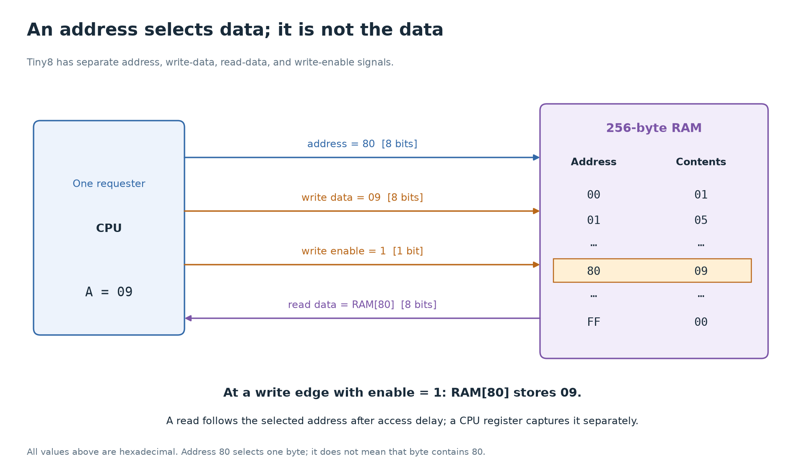

# 5. Memory, addresses, and buses

[Foundations](../README.md) · [Previous: state and the clock](04-state-and-clock.md) · [Next: CPU architecture](06-cpu-architecture.md)

A register gives a circuit a place to keep one working value. A memory gives it many numbered places. The important new operation is selection: present an address, and the memory accesses the corresponding entry.

By the end of this lesson, you should be able to distinguish an address from its contents, calculate a memory's capacity, and explain the timing and direction of Tiny8's memory interface.

## An address names a place; data is what sits there

Consider this four-entry memory:

| Address | Byte stored there, in hexadecimal | Unsigned decimal interpretation |
| --- | --- | --- |
| `00` | `2A` | 42 |
| `01` | `07` | 7 |
| `02` | `00` | 0 |
| `03` | `FF` | 255 |

The address `01` is the name of a slot. The byte `07` is its content. Reading address `01` produces 7. It does not produce 1, and it does not automatically treat 7 as another address to read.

A value becomes a pointer, instruction, character, or ordinary number because a surrounding system interprets it that way. The memory cells themselves retain bit patterns.

Tiny8's accumulator stores one 8-bit value. Its intended memory stores 256 separate 8-bit values. One byte can be selected at a time through this memory interface.

## Address width and data width answer different questions

For a fully populated memory interface:

- `a` address bits select up to `2^a` distinct entries.
- `d` data bits give each entry a width of `d` bits.
- Capacity is `2^a × d` bits.

Tiny8 has an 8-bit address and an 8-bit data path. It can select `2^8 = 256` byte entries, at addresses `00` through `FF`. Capacity is `256 × 8 = 2048` bits, or 256 bytes.

Compare three designs:

| Address bits | Bits per entry | Entries | Total bytes |
| --- | --- | --- | --- |
| 8 | 8 | 256 | 256 |
| 8 | 16 | 256 | 512 |
| 9 | 8 | 512 | 512 |

The second design still has only 256 addressable entries; each entry is now two bytes wide. Whether an architecture numbers individual bytes or wider words is a separate choice. Tiny8 numbers bytes.

The width of an ALU, the width of an address, and the amount of installed memory can differ. A processor described as “64-bit” does not necessarily implement 64 physical address bits or contain `2^64` bytes of RAM.

## An array is different from one wide value

SystemVerilog distinguishes a packed vector from an unpacked array. This example describes sixteen entries of four bits each:

```systemverilog
logic [3:0] cells [0:15];
logic [3:0] selected;

assign selected = cells[index];
```

The range before the variable name, `[3:0]`, makes each entry a four-bit packed value. The range after the name, `[0:15]`, declares sixteen array entries. Here `index` must be an appropriately declared four-bit address signal.

`cells[3]` selects the entire four-bit entry at address 3. `cells[3][0]` selects bit 0 within that entry. A declaration such as `logic [63:0] flat;` instead declares one 64-bit packed value. Both declarations describe 64 bits in total, but their indexing and intended interfaces differ.

An RTL array declaration does not by itself guarantee a particular physical memory block. Its access patterns, read/write timing, target technology, and synthesis tool affect whether it becomes flip-flops, distributed memory, a dedicated RAM block, or another implementation.

## A read needs an address and a timing contract

A memory interface must specify **when** valid read data will be available. Two common contracts are:

| Read interface | What initiates the read | When data is available |
| --- | --- | --- |
| Asynchronous/combinational read | Presenting or changing the address | After the memory's access delay; no clock edge is required for selection |
| Synchronous/registered read | Sampling the address or read request at an edge | According to a specified clocked latency, often visible after that edge for a one-stage port |

The intended Tiny8 [memory module](../../verilong/cpu/src/memory.sv) uses a combinational read. In an ideal RTL model, its read data follows `ram[addr]` as combinational events settle. In a physical implementation, selecting a different entry takes time.

Suppose address `20` holds `7B`:

1. The CPU drives `mem_addr = 20`.
2. The memory's read-selection logic chooses that entry.
3. After the read path settles, `mem_rdata = 7B`.
4. A destination register can capture `7B` at a later edge, provided timing requirements are met.

The memory output and the CPU register are different places. Seeing `7B` on a wire does not mean the accumulator has stored it.

A synchronous memory changes that schedule. If its address is sampled at an edge, downstream logic must respect its defined latency rather than pretending the output had already followed the address before the edge. Replacing an asynchronous RAM with a synchronous RAM can require controller changes, even if capacity and data widths stay identical. “RAM” is not a sufficient interface specification.

## A write needs permission, data, an address, and an edge

Tiny8's intended writes are synchronous. At a rising clock edge, memory stores the supplied data only when its write enable is high.

| Signal before the edge | Example | Meaning |
| --- | --- | --- |
| `mem_addr` | `20` | Select byte entry `20` |
| `mem_wdata` | `55` | Value to store |
| `mem_we` | 1 | Authorize the write at this edge |

After that write, entry `20` holds `55`; the other entries retain their values. When `mem_we` is 0, the address and write-data wires can still carry values, but no write occurs.

Address, write data, and write enable must be valid around the receiving edge. They do not take turns arriving as separate software arguments. They are simultaneously present signals interpreted by the memory hardware.

If the write address is also the currently selected combinational read address, the read data will reflect the updated stored value after the model's write update and read logic settle. Other memories can specify different read-during-write behavior, especially clocked RAM blocks and dual-port RAMs. Always check the particular interface contract rather than assuming all memories agree.

## The bus is several groups of signals

In this project, the CPU and RAM are connected using separate address, write-data, and read-data signals:

| Tiny8 CPU signal | Width | Direction | Role |
| --- | --- | --- | --- |
| `mem_addr` | 8 | CPU → memory | Select the entry |
| `mem_wdata` | 8 | CPU → memory | Supply a byte for a write |
| `mem_rdata` | 8 | Memory → CPU | Return the selected byte |
| `mem_we` | 1 | CPU → memory | Enable a write |
| `clk` | 1 | Clock source → both | Coordinate storage updates |

The names are relative to the CPU. The RAM module calls the corresponding ports `addr`, `wdata`, `rdata`, and `we`. The connections are visible in [tiny8.sv](../../verilong/cpu/src/tiny8.sv).

Calling these signals a **bus** does not mean there is one wire carrying an entire byte. A parallel 8-bit data path has eight bit signals. It also does not mean all participants can drive those signals whenever they want.

A signal can feed several inputs. This is **fan-out**: one source is observed by several destinations. For example, memory's read data can connect to the instruction register's input and the accumulator's input at the same time. Control signals determine which destination actually stores it. More physical loads can increase delay and require buffering.

Several independent sources driving one ordinary signal can conflict. A digital system must provide a defined selection or electrical protocol. Inside an FPGA, selection is commonly implemented with muxes rather than a physical tri-state bus. At some external interfaces, tri-state drivers allow a device to disconnect its output, represented as `Z` in simulation; only authorized devices should drive the line at a time.

Tiny8 has one CPU requesting memory accesses, so it needs no multi-master arbitration. A larger system might have a CPU, DMA engine, and other requesters. An **arbiter** chooses which requester receives access. A practical interconnect also specifies requests, responses, waiting, and which device owns each transaction. Wires alone do not establish those rules.



Trace each arrow in its indicated direction. To read a location, send its
address toward memory and observe the selected byte coming back. To write,
present address and data together, then assert write enable for the write edge.

## A shared memory makes the controller choose

Tiny8 puts program bytes and ordinary data in the same memory. Its single address port cannot simultaneously select an instruction address and a different data address.

During instruction fetch, the CPU presents PC. During an absolute data access, it presents the stored operand address. A mux chooses which source reaches the address port. The controller schedules these activities into different states.

This is one reason datapath design and sequencing belong together: the available ports constrain what can happen in one cycle. A design with separate instruction/data memories or additional ports can permit different overlaps, but adds other costs and rules.

The stored-program idea does not require every modern CPU to use one physical path for every access. Many CPUs present a unified address space to software while having separate instruction and data caches internally.

## The different things people call memory

All of these retain information, but their roles and implementation differ:

| Component | Typical role | Important distinction |
| --- | --- | --- |
| Working register | Hold a value currently used by the datapath | Often built from flip-flops; directly available to nearby logic |
| Register file | Store a CPU's named working registers | Organized around instruction operand ports; implementation varies |
| SRAM | On-chip caches and other fast memories | Holds data while powered without periodic refresh; uses more area per bit than DRAM |
| DRAM | Main memory with large capacity | Requires refresh; accesses follow a more involved timing protocol |
| ROM | Fixed contents or contents programmed by a supported mechanism | Read-only during its normal use; the underlying technology can vary |
| SSD | Persistent file and block storage | Commonly uses flash plus a controller; does not behave like the simple RAM port shown here |
| Cache | Keep copies of useful memory data near a processor | A role, usually implemented with SRAM, plus tags and control logic |

“Static” in SRAM does not mean it survives power loss. Both ordinary SRAM and DRAM are volatile. “Random access” means locations can be selected by address; it does not mean every access has identical latency under every condition.

Tiny8's array is a small educational RAM abstraction. It contains no DRAM refresh controller, storage device, cache tags, virtual memory, or operating system. A testbench can preload bytes directly because the simulation environment is supplying the initial program. A physical system would need a defined boot or loading mechanism.

## Endianness starts when one value spans several addresses

Tiny8's native data operations use one byte. Within one byte, endianness does not change the positions or significance of its bits.

For a larger machine, suppose a 16-bit value `1234` in hexadecimal occupies two byte addresses, `100` and `101`:

| Convention | Byte at address `100` | Byte at address `101` |
| --- | --- | --- |
| Little-endian | `34` | `12` |
| Big-endian | `12` | `34` |

Little-endian puts the least significant byte at the lower address. Big-endian puts the most significant byte there. The numeric value is still `0x1234`; the byte ordering in memory differs. A protocol or ISA must specify the ordering when software assembles multi-byte values.

## Check your understanding

1. A memory has 10 address bits and 8 data bits per entry. How many entries and bytes can it hold? What changes if the data width becomes 16 bits?
2. If entry `40` contains `A2`, what appears on a combinational read-data port when the address is `40`? Does that automatically change the accumulator?
3. What conditions must be present for a Tiny8 memory write to happen? Why does setting the write-data wire alone do nothing?
4. Why might replacing Tiny8's intended memory with a clocked-read memory break the controller without changing any instruction opcode?
5. Why can two destinations observe one read-data wire safely while two sources cannot simply drive that same wire independently?

<details>
<summary>Answers</summary>

1. There are `2^10 = 1024` entries, each one byte, for 1024 bytes. With 16-bit entries there are still 1024 entries, but capacity becomes 2048 bytes.
2. `A2` appears after the read path settles. The accumulator changes only when its own storage logic captures a value.
3. At the rising edge, write enable must be high and the address and data must be valid around that edge. Write data alone supplies a possible value; write enable authorizes storing it.
4. The controller may try to capture data before the new memory makes it available. Opcode meanings can remain unchanged while the implementation needs additional states or different scheduling.
5. Inputs can observe a source without attempting to replace its value. Two output drivers can disagree, so the design needs selection, arbitration, or a defined shared-line electrical scheme.

</details>

Continue to [CPU architecture](06-cpu-architecture.md), where these memory transactions become instruction fetches, loads, and stores. Further background is collected in the [references](references.md).
