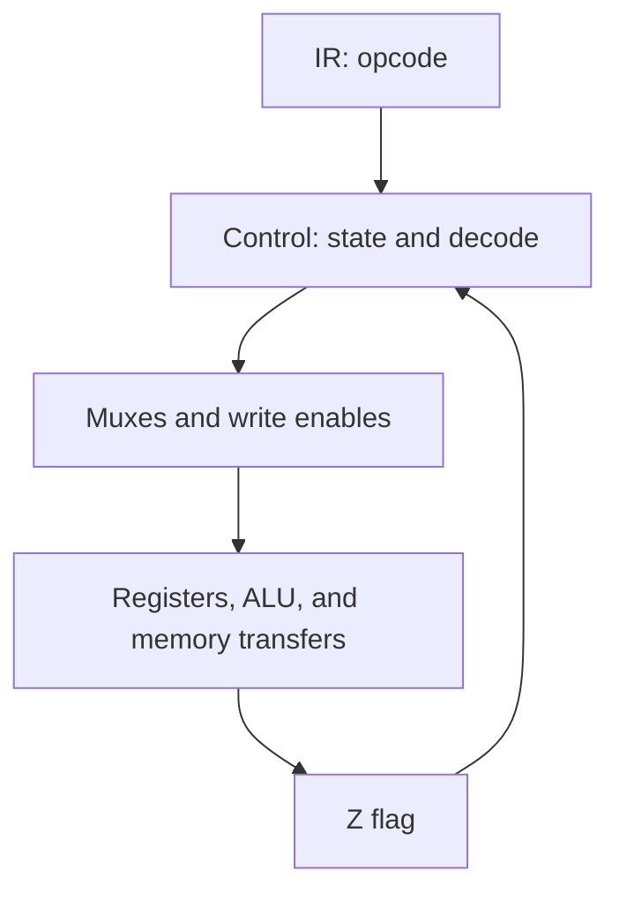
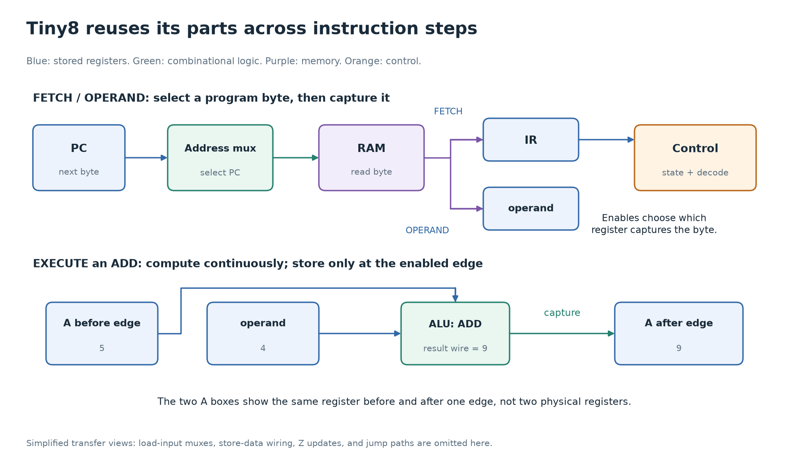
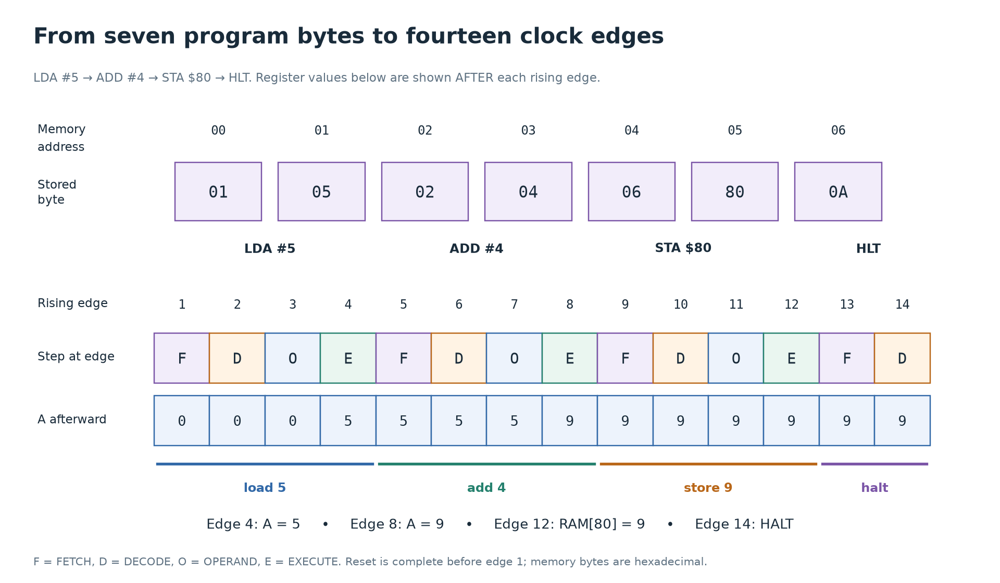

# 6. From circuits to a CPU

[Primer](../README.md) · [Previous: memory and buses](05-memory-and-buses.md) · [Next: modern processors](07-modern-processors.md)

You now have enough parts to build a machine that follows instructions: storage, arithmetic, selectors, and a state machine. The remaining question is how those parts make a byte such as `02` mean “add.”

This chapter describes **Tiny8's intended behavior**. The SystemVerilog files are exercises with TODOs, so the trace below is a specification to work toward, rather than a claim that the unfinished RTL already runs it.

## A computer, a processor, and a core

A computer contains processors, working memory, persistent storage, and input/output devices. A CPU executes machine instructions. RAM holds instructions and working data. An SSD retains files when power is removed. Device controllers connect computation to such things as a display, network, or keyboard.

A **core** is an instruction-executing engine within a processor. A processor package can contain several cores, caches, and other components. A **system on a chip** can also contain a GPU and device controllers. “Processor,” “core,” and “computer” therefore describe different boundaries.

Tiny8 models one small CPU connected to one memory. A testbench loads its program and inspects the result. It has no operating system, filesystem, keyboard controller, cache, or multiple cores. Those components become easier to understand after you can follow this smaller machine.

## The instruction set is a contract

An **instruction set architecture**, or ISA, defines the instructions a machine understands and their visible effects. For Tiny8, `02 04` means “add the constant 4 to A.” This is a rule of the ISA.

The **microarchitecture** is the circuit arrangement that carries out that contract. Tiny8 uses one accumulator, an ALU, and a controller that takes several clocks per instruction. Another implementation could execute the same instructions with a different state machine or a pipeline. It would need to preserve the specified results.

Assembly gives instructions readable names. Machine code gives them their encoded bit patterns. An **assembler** translates names and operands into those bytes. The letters `ADD` do not enter the ALU: an opcode decoder recognizes the stored number and selects the arithmetic circuit.

Programs and data share Tiny8's memory. A byte has no permanent “instruction” tag. If the CPU fetches a byte as an opcode, the decoder interprets it that way. If a load reads it as data, it is a value. This explains both the flexibility of a stored-program computer and the danger of jumping into the wrong address.

## The state you must follow

| Name | Width | What it remembers |
| --- | --- | --- |
| `PC` | 8 bits | The address of the next **program byte** to fetch. During an instruction, that may be its operand byte. |
| `IR` | 8 bits | The opcode already fetched. |
| `operand` | 8 bits | The second instruction byte, when the instruction has one. |
| `A` / `acc` | 8 bits | The accumulator, Tiny8's working value. |
| `Z` / `z_flag` | 1 bit | Whether the last write to A produced zero, except for the explicit reset value. |
| `state` | 3 bits | Which controller step is active. |
| Memory | 256 × 8 bits | Program bytes and data bytes. |

Reset sets PC, IR, operand, and A to zero, Z to **0**, and the controller to FETCH. Reset does not establish Z by comparing A with zero: it explicitly clears the flag. Thus immediately after reset A is 0 while Z is 0. A later load or ALU result updates the flag normally. RAM contents are not cleared by the CPU reset in this design; the testbench must initialize the locations a program relies on.

## Tiny8's complete instruction set

The names and encodings come from [cpu_pkg.sv](../../verilong/cpu/src/cpu_pkg.sv). Opcode bytes below are hexadecimal. `nn` is an immediate byte; `addr` is an address byte. `#` means “use the following byte as the value.” `$80` denotes hexadecimal address `80` in the explanatory assembly used here.

| Opcode | Assembly | Bytes | Effect | Z |
| --- | --- | --- | --- | --- |
| `00` | `NOP` | 1 | Continue without changing A or memory. | Retain |
| `01` | `LDA #nn` | 2 | `A = nn` | Set from new A |
| `02` | `ADD #nn` | 2 | `A = (A + nn) mod 256` | Set from new A |
| `03` | `SUB #nn` | 2 | `A = (A - nn) mod 256` | Set from new A |
| `04` | `AND #nn` | 2 | Bitwise AND of A and nn into A. | Set from new A |
| `05` | `OR #nn` | 2 | Bitwise OR of A and nn into A. | Set from new A |
| `06` | `STA addr` | 2 | `memory[addr] = A` | Retain |
| `07` | `LDA addr` | 2 | `A = memory[addr]` | Set from new A |
| `08` | `JMP addr` | 2 | Set PC to addr. | Retain |
| `09` | `JZ addr` | 2 | Set PC to addr if Z is 1; otherwise continue. | Retain |
| `0A` | `HLT` | 1 | Enter HALT and remain there until reset. | Retain |

All additions and subtractions retain only eight result bits. For example, `255 + 1` produces `0`, setting Z. `0 - 1` produces `255`, clearing Z. Tiny8 has no separate carry or signed-overflow flag. PC also wraps from `FF` to `00` when incremented.

Bytes outside the listed opcodes have no specified instruction behavior in the exercise contract. Do not assume they are NOPs, traps, or HALTs. Defining an illegal-instruction policy would be an extension to the design.

## Datapath moves values; control chooses transfers

The **datapath** contains A, PC, IR, operand, the ALU, memory connections, and muxes. The **control unit** examines the opcode, current state, and Z to select transfers.

For an add, the datapath already presents A and operand to the ALU. Control selects ADD, enables A to capture the result at the proper edge, and chooses FETCH as the next state. The control unit does not need to add the numbers itself.

For a store, the address mux selects operand rather than PC. A drives memory's write-data input. Control raises write-enable for the store edge. A decoder recognizes an instruction; a state machine determines **when** its effects happen.



This diagram shows control relationships, rather than every data wire. The [existing datapath picture](../../verilong/cpu/intro.md#7-datapath-and-control-tiny8-up-close) shows the larger set of connections.



Read this picture in two passes. First follow values: PC supplies an
instruction address, memory supplies an opcode or operand, and A plus the
operand feed the ALU. Then follow control: mux selects choose which value
travels where, and register enables choose which arriving value is stored.

## One program, from bytes to result

Consider this program:

```text
LDA #5
ADD #4
STA $80
HLT
```

Its memory image is:

| Address, hex | Byte, hex | Interpretation |
| --- | --- | --- |
| `00` | `01` | LDA immediate opcode |
| `01` | `05` | Constant 5 |
| `02` | `02` | ADD immediate opcode |
| `03` | `04` | Constant 4 |
| `04` | `06` | STA opcode |
| `05` | `80` | Destination address |
| `06` | `0A` | HLT opcode |
| `80` | `00` initially | Data destination, initialized to zero for this example |

Address `05` holds the value `80`, and address `80` will eventually hold `09`. An address and the value stored there are different numbers.

Each row below records values **after** a rising edge. “State before edge” determines the action taken at that edge. Hexadecimal is used for PC, IR, operand, A, and the memory value. Reset is already complete before row 1.

| Edge | State before edge | PC | IR | operand | A | Z | mem[`80`] | State after edge |
| --- | --- | --- | --- | --- | --- | --- | --- | --- |
| Reset | Reset | `00` | `00` | `00` | `00` | 0 | `00` | FETCH |
| 1 | FETCH | `01` | `01` | `00` | `00` | 0 | `00` | DECODE |
| 2 | DECODE | `01` | `01` | `00` | `00` | 0 | `00` | OPERAND |
| 3 | OPERAND | `02` | `01` | `05` | `00` | 0 | `00` | EXECUTE |
| 4 | EXECUTE | `02` | `01` | `05` | `05` | 0 | `00` | FETCH |
| 5 | FETCH | `03` | `02` | `05` | `05` | 0 | `00` | DECODE |
| 6 | DECODE | `03` | `02` | `05` | `05` | 0 | `00` | OPERAND |
| 7 | OPERAND | `04` | `02` | `04` | `05` | 0 | `00` | EXECUTE |
| 8 | EXECUTE | `04` | `02` | `04` | `09` | 0 | `00` | FETCH |
| 9 | FETCH | `05` | `06` | `04` | `09` | 0 | `00` | DECODE |
| 10 | DECODE | `05` | `06` | `04` | `09` | 0 | `00` | OPERAND |
| 11 | OPERAND | `06` | `06` | `80` | `09` | 0 | `00` | EXECUTE |
| 12 | EXECUTE | `06` | `06` | `80` | `09` | 0 | `09` | FETCH |
| 13 | FETCH | `07` | `0A` | `80` | `09` | 0 | `09` | DECODE |
| 14 | DECODE | `07` | `0A` | `80` | `09` | 0 | `09` | HALT |

Notice what **does not** change on edge 7: A is still 5. The operand register has just captured 4. After this edge, the combinational ALU settles to 9. Only edge 8 stores that 9 in A.

Likewise, IR retaining `06` after the store is harmless. IR only needs a new value when the next opcode is fetched. Registers retain their previous values unless an enabled transfer replaces them.

The program finishes with A = 9 and memory[`80`] = 9. It takes 14 active rising edges after reset to enter HALT. HLT needs FETCH and DECODE, without a separate EXECUTE step.

Run the optional [Python teaching model](../experiments/03_tiny8.py) from the repository root:

```sh
python3 cpu-architecture/experiments/03_tiny8.py
```

The model illustrates the intended transitions. It does not simulate the SystemVerilog or prove your RTL implements those transitions. When working on the RTL, compare actual testbench observations against the contract.



Use the phase bands to locate the row in the detailed table where each
architectural change occurs. Fetching an operand makes it available to the
datapath; storing the instruction result happens at a later edge.

## A branch is a conditional replacement of PC

Suppose the program bytes represent:

| Address | Instruction | Effect |
| --- | --- | --- |
| `00` | `LDA #1` | A becomes 1, Z becomes 0. |
| `02` | `SUB #1` | A becomes 0, Z becomes 1. |
| `04` | `JZ $08` | Jump to `08` because Z is 1. |
| `06` | `LDA #99` | Skipped. |
| `08` | `HLT` | Stop. |

Fetching the branch operand advances PC from `05` to `06`. During the branch's EXECUTE step, the controller loads `08` into PC. The next FETCH therefore reads address `08`.

If Z had been 0, PC would have retained `06`, and execution would have continued at the skipped load. The branch instruction does not set Z itself. It reads a result remembered from an earlier instruction.

## Why does a memory load have an extra state?

The intended Tiny8 memory has a combinational read: changing its address changes read-data after propagation delay, without waiting for a memory clock edge. Stores happen on a rising edge when write-enable is high.

`LDA addr` passes through FETCH, DECODE, OPERAND, EXECUTE, and LOAD. EXECUTE selects the data address and moves the controller into LOAD. LOAD captures memory data into A, updates Z, and returns to FETCH. The address must remain selected correctly until the capture edge.

This extra state makes the teaching sequence explicit. It is not proof that the RAM has a one-clock read latency. A different controller could capture the same asynchronous read in EXECUTE if its address selection and timing supported that. A synchronous-read RAM would instead require designing around the RAM's actual registered-read contract.

For this intended controller, NOP takes three edges; immediate operations, stores, and jumps take four; an absolute load takes five; HLT takes two to enter HALT. The number of instructions and number of cycles are different quantities.

## Where these ideas live in the repository

| Circuit or contract | Source | What to look for |
| --- | --- | --- |
| ISA and state names | [cpu_pkg.sv](../../verilong/cpu/src/cpu_pkg.sv) | Opcode constants, state enum, ALU operation enum. |
| ALU | [alu.sv](../../verilong/cpu/src/alu.sv) | Operand selection by operation, result, combinational zero test. |
| Instruction decoding | [decoder.sv](../../verilong/cpu/src/decoder.sv) | Opcode-to-control facts, without a clock. |
| Program counter | [pc.sv](../../verilong/cpu/src/pc.sv) | Reset, jump load, increment, and hold priority. |
| Memory | [memory.sv](../../verilong/cpu/src/memory.sv) | Addressed array, edge write, combinational read. |
| Datapath and controller | [cpu.sv](../../verilong/cpu/src/cpu.sv) | Accumulator and instruction registers, memory muxes, control states. |
| Top-level wiring | [tiny8.sv](../../verilong/cpu/src/tiny8.sv) | Persistent connections between CPU and memory ports. |
| Simulation environment | [cpu_tb.sv](../../verilong/cpu/tb/cpu_tb.sv) | Clock, reset, program initialization, result checks. |

The CPU's combinational `alu_zero` signal and its stored `z_flag` are different. The first describes the ALU output right now. The second remembers whether the last architectural write to A produced zero. A branch uses the remembered flag, even when the ALU currently has unrelated inputs.

## Check your understanding

1. Why does PC equal `02` after the first load finishes, rather than `01`?
2. What distinguishes `LDA #128` from `LDA $80`, even though both operand bytes are hexadecimal `80`?
3. After reset, why is `JZ` not guaranteed to jump even though A is zero?
4. At edge 7 in the trace, which register changes, and why does A wait?
5. Could a pipelined Tiny8 implementation have the same ISA as this multi-cycle design?

<details>
<summary>Answers</summary>

1. The instruction has two bytes: its opcode at `00` and operand at `01`. Fetching each increments PC, leaving it at `02`.
2. The immediate form copies a constant byte into A. The addressed form reads the byte stored at memory address hexadecimal `80`. The notation alone does not change the circuit; different opcodes tell the controller which meaning to use.
3. Reset explicitly clears Z to 0. Z is not a continuously evaluated comparison with A; later writes to A update it.
4. Operand captures `04`. A still holds `05`. The ALU computes from these stored inputs after the edge, and A captures its result at the later EXECUTE edge.
5. Yes. The implementation can change while preserving specified instruction results and control flow. It must also handle dependencies and any other externally specified behavior correctly.

</details>

[Primary references](references.md) · [Next: how modern processors go faster](07-modern-processors.md)
