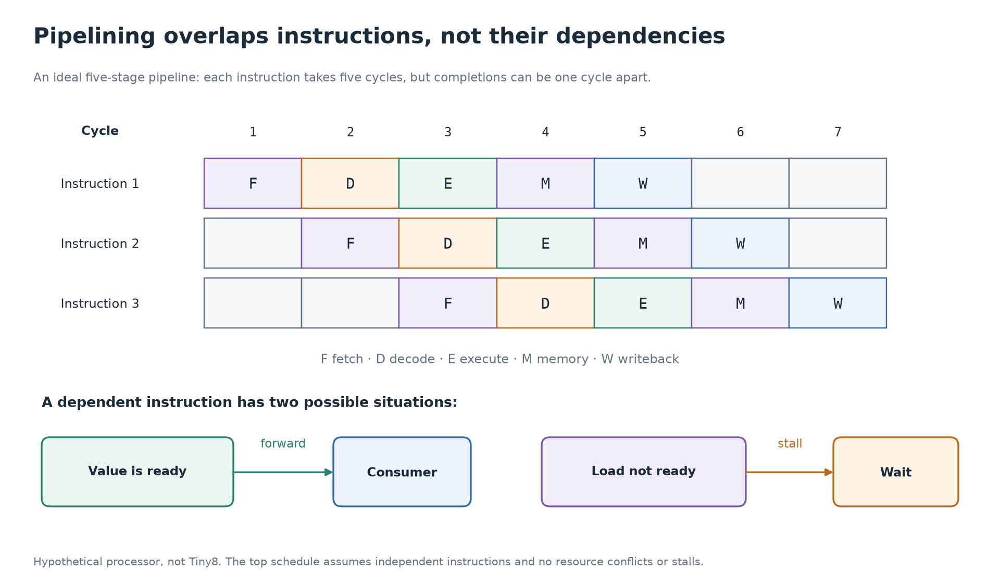
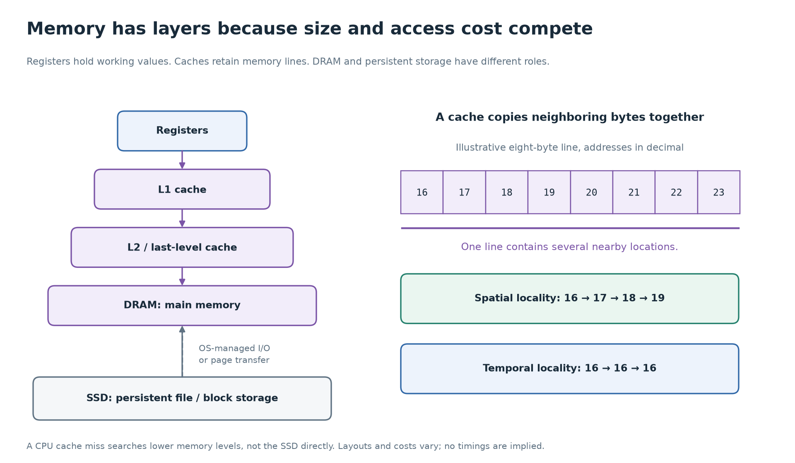

# 7. How modern processors build on these parts

[Primer](../README.md) · [Previous: CPU architecture](06-cpu-architecture.md) · [Next: SystemVerilog](08-systemverilog.md)

Tiny8 makes one instruction visible at a time. Larger processors use the same underlying circuit ideas, but add hardware to overlap work and keep arithmetic units supplied with values. This chapter explains what those additions accomplish and what makes them difficult.

The stage counts, cache timings, and performance numbers below are teaching examples. They are not specifications for your laptop. Tiny8 has none of the pipeline, cache, prediction, or parallel-execution features discussed here.

## Multi-cycle execution and pipelining

Tiny8 reuses its hardware over several states and completes the current instruction before fetching another. That is a **multi-cycle** implementation.

A **pipeline** places registers between stages so different instructions can occupy different stages at once. The ALU still takes time to compute. The gain comes from processing a new instruction while an older instruction is elsewhere in the machine.

Imagine a simple processor with five stages: fetch (F), decode/register read (D), execute (E), memory access (M), and register writeback (W). These are a hypothetical processor's stages, rather than Tiny8's controller states.

| Instruction | Cycle 1 | 2 | 3 | 4 | 5 | 6 | 7 |
| --- | --- | --- | --- | --- | --- | --- | --- |
| I1 | F | D | E | M | W | | |
| I2 | | F | D | E | M | W | |
| I3 | | | F | D | E | M | W |

Each instruction still takes five cycles to pass through the pipeline. Once filled, this ideal pipeline can finish one instruction per cycle. Three independent instructions take seven cycles, rather than fifteen cycles in an otherwise comparable non-overlapped design.

**Latency** is how long one item takes from start to finish. **Throughput** is how many items finish per unit of time. Pipelining can improve throughput without reducing an individual instruction's latency. Real stage registers add delay and consume energy, so adding more stages is not free.



Follow one row for instruction latency, then one column for simultaneous
work. The dependency panel explains why the ideal staggered schedule cannot
be assumed for every instruction sequence.

## Dependencies create hazards

Overlapping instructions is useful only if the answer stays correct. A **hazard** is a condition that prevents an instruction from proceeding as the simple pipeline schedule assumes.

| Kind | Concrete problem | Common response |
| --- | --- | --- |
| Data | `ADD r2, r1, r3` needs the value that an older instruction is about to write into `r1`. | Forward the available result, or stall until it is available. |
| Control | A branch's destination or condition is unresolved while the fetch stage needs the next address. | Stall, predict a path, and recover if necessary. |
| Structural | Fetch and a data load both need the only memory port in the same cycle. | Add ports or separate resources, or stall one request. |

Here `ADD r2, r1, r3` is illustrative assembly meaning `r2 = r1 + r3`; it is not a Tiny8 instruction.

**Forwarding**, also called bypassing, routes a result directly from a later stage to a consumer rather than waiting for it to be written and read through the register file. This requires muxes, wires, and dependency comparisons. It cannot forward a value that does not yet exist. A load whose data arrives late can still force a stall.

A **stall** holds an instruction or stage in place. Downstream stages may continue, leaving an empty slot called a bubble. Control must coordinate all relevant enables so a stalled instruction does not accidentally perform its write twice.

## More registers reduce unnecessary memory traffic

Tiny8 routes most arithmetic through one accumulator. A larger ISA often exposes several working registers. A **register file** stores them and commonly provides multiple read ports plus one or more write ports.

An addition can read two source registers and write a third. Intermediate results can remain nearby instead of repeatedly traveling to main memory. The register file itself is hardware with size, timing, wiring, and power costs; its ports are not unlimited.

Architectural registers are those named by the ISA. Some processors also use additional **physical registers** internally. Register renaming maps architectural names to physical storage, helping separate true value dependencies from accidental reuse of a register name.

## Clock speed is only one part of execution time

For a measured execution, a useful accounting identity is:

```text
execution time = instruction count × average cycles per instruction × clock period
              = instruction count × average CPI / clock frequency
```

Suppose a program executes one million instructions. At average CPI = 2 and a 1 GHz clock, it takes:

```text
1,000,000 × 2 / 1,000,000,000 = 0.002 seconds = 2 milliseconds
```

Suppose another implementation executes the same instruction count at 2 GHz, but average CPI rises to 5 because of stalls. It takes 2.5 milliseconds. The higher-frequency machine is slower for this example because it needs more cycles overall.

These calculations assume the stated average CPI includes the relevant stalls during the measured interval. Comparisons must also account for different instruction counts, compiler decisions, memory behavior, and the work actually completed. Superscalar processors can finish more than one instruction per cycle, so average CPI can be below 1. Frequency alone cannot describe application performance.

## Caches make nearby copies useful

Main memory is much larger than the working storage inside a core, but accessing it can take many core cycles. A **cache** retains copies of memory blocks so repeated accesses can often use a nearer structure.

Two patterns make caches effective:

- **Temporal locality:** recently used values are likely to be used again, as with a loop's repeated accesses.
- **Spatial locality:** nearby addresses are likely to be used soon, as with scanning an array.

A cache usually transfers a **cache line**, a block of consecutive bytes. A lookup compares an address tag with stored tags. On a **hit**, the cache supplies the requested data. On a **miss**, the system obtains the line from another cache level or main memory, potentially delaying dependent work.

| Place | Main role |
| --- | --- |
| Registers | Values named directly by instructions or tracked internally by execution hardware. |
| L1 cache | A small nearby cache; instruction and data caches are often separate. |
| L2 / last-level cache | Larger caches that reduce trips to main memory; sharing arrangements vary. |
| DRAM | Main working memory for programs and their data. |
| SSD | Persistent storage reached through I/O; ordinary cache misses do not directly fetch an SSD block. |

The operating system can use storage to back virtual-memory pages, but a page fault and a CPU cache miss are different events. Cache behavior alone does not explain how a file becomes a process's memory.

For a simple serial-access model:

```text
average memory access time = hit time + miss rate × additional miss penalty
```

With 1 ns hit time, a 5% miss rate, and 50 ns of **additional** miss penalty, the average is `1 + 0.05 × 50 = 3.5 ns`. This model assumes each access first pays the hit-lookup time; a miss adds the stated penalty. Real processors may overlap misses and computation, so average access time does not translate directly into program execution time.

Caches also need a policy for writes. A write-through cache sends writes onward promptly; a write-back cache can keep modified data and send it onward later. When cores cache the same memory, **cache coherence** coordinates copies. Coherence does not by itself prevent software data races or replace synchronization.



The levels describe roles rather than measured sizes or latencies. Trace
the repeated accesses to one value for temporal locality and neighboring
bytes for spatial locality. An SSD belongs to the storage and I/O path;
it is not the next ordinary cache-miss destination after DRAM.

## Branch prediction keeps fetching useful work

A branch can depend on a result that has not yet reached the needed stage. Waiting for every branch would repeatedly stop the front of a pipeline.

A **branch predictor** guesses whether a branch will be taken and often predicts its target. Fetch proceeds along that guess. Later hardware checks the actual outcome. A correct prediction preserves useful overlap. A wrong prediction requires discarding younger work from the wrong path and fetching from the correct address.

Executing before knowing whether the work is needed is **speculation**. The processor must control when results become architecturally committed. Wrong-path instructions must not commit their normal register or memory updates. Their internal cache or predictor effects can still have consequences, which is why speculation also matters in computer security.

Prediction changes how the machine obtains performance. It does not permit a conditional jump to choose whichever result is convenient.

## Out-of-order execution uses ready work

Suppose instruction I1 is waiting for a memory load, I2 depends on I1, and I3 computes an unrelated addition. A processor that strictly executes in order may leave useful hardware idle. An **out-of-order** implementation can execute I3 while I1 waits, if it has established that doing so is permitted.

This requires hardware to track operands, dependencies, execution resources, and outstanding memory operations. **Superscalar** means the machine can issue or complete multiple instructions per cycle at relevant points; it is related to, but different from, out-of-order scheduling.

Many out-of-order designs retain results internally and **retire** instructions in program order. Retirement makes the instruction's result part of committed architectural state. This supports **precise exceptions**: software can observe a consistent boundary where older instructions have completed and younger instructions have not committed. Memory ordering rules and externally visible I/O effects impose additional restrictions; “independent” cannot be decided by looking only at register names.

The larger design still consists of stored state, comparisons, muxes, arithmetic circuits, and control. The challenge is keeping many partially completed operations consistent with one ISA contract.

## Different forms of parallel work

| Feature | What is duplicated or widened | What it allows |
| --- | --- | --- |
| Pipelining | Stage storage and control | Different instructions occupy different stages. |
| Superscalar execution | Issue paths and execution resources | Several suitable instructions proceed within one core in a cycle. |
| Multiple cores | Instruction-executing engines | Different software threads run on different cores. |
| Simultaneous multithreading, SMT | Architectural thread state, with shared core resources | A core can draw work from more than one hardware thread. |
| SIMD / vector instructions | Operations across multiple data lanes | One instruction operates on several elements. |
| GPU execution | Many arithmetic resources and many tracked threads, with grouped execution | High throughput on large collections of suitable parallel work. |

These features can coexist. A core might be pipelined, superscalar, out of order, and support SIMD and SMT. A GPU is also built from instruction-executing circuits, but organizes resources and scheduling differently from a typical general-purpose CPU core. Neither “more cores” nor “use a GPU” automatically accelerates a dependency-heavy task.

## Where the operating system enters

The operating system is software running on processors. Hardware provides mechanisms that help it manage the computer: privilege levels, address translation, timers, interrupts, and exceptions, among others.

An **interrupt** reports an event such as a timer expiration or device request. An **exception** arises from instruction execution, such as an invalid memory access. A system call deliberately requests operating-system service through a defined instruction or trap mechanism. The exact vocabulary and saved state depend on the architecture.

Hardware transfers control to a designated handler using its architectural rules. The handler is software. An operating-system context switch can then save one thread's architectural state and restore another's. Switching a thread is therefore a different level of control from Tiny8's state machine moving from FETCH to DECODE.

Tiny8 has no interrupts, privilege levels, virtual memory, or context switching. Its controller is an implementation of instruction execution, not an operating system.

## Check your understanding

1. In the ideal five-stage table, how can an instruction take five cycles while one instruction finishes every cycle?
2. Why can forwarding fail to eliminate a load-use stall?
3. What is the average access time for a 2 ns hit time, 10% miss rate, and 40 ns additional miss penalty?
4. What must a processor do if a branch prediction is wrong?
5. How do a controller state transition and an operating-system context switch differ?

<details>
<summary>Answers</summary>

1. Several instructions are in flight at once. Each traverses five stages, but their completion times are staggered one cycle apart after the pipeline fills. Latency and throughput measure different things.
2. Forwarding can route an already available value. If the load's data arrives after the consuming stage needs it, the consumer still has to wait.
3. `2 + 0.10 × 40 = 6 ns`, under the stated simple serial-access model.
4. Discard younger wrong-path work before it commits ordinary architectural results, restore the correct execution path, and fetch from the correct address. Internal side effects can remain, so recovery is not a guarantee that no microarchitectural effect occurred.
5. A controller transition advances the hardware steps used to carry out an instruction. A context switch is operating-system work that changes which software thread's architectural state is active on a processor.

</details>

[Primary references](references.md) · [Next: expressing circuits in SystemVerilog](08-systemverilog.md)
