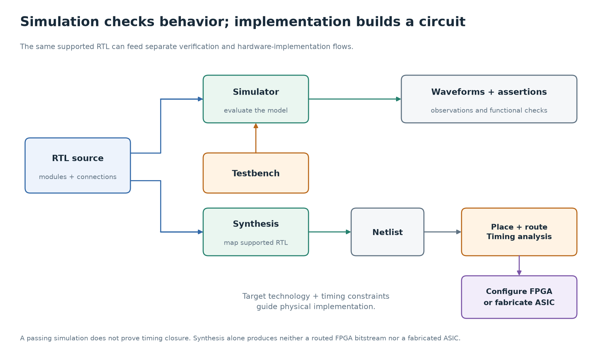

# 8. Read SystemVerilog as a circuit

[Primer](../README.md) · [← Modern processors](07-modern-processors.md) · [Next: practice →](practice.md)

You now know the things a small CPU needs: gates, muxes, registers, memory,
and a controller. SystemVerilog is a language for describing their behavior
and connections precisely enough that tools can simulate them. Its
synthesizable subset can also describe a circuit that implementation tools
map to an FPGA or ASIC.

SystemVerilog also includes a large verification language. A testbench and
a chip design can use the same language while having different jobs.

## 8.1 A module describes a component

Here is a complete component, independent of the unfinished CPU:

```systemverilog
module pipeline_pair (
  input  logic       clk,
  input  logic       rst,
  input  logic       enable,
  input  logic [7:0] data_in,
  output logic [7:0] stage1,
  output logic [7:0] stage2
);
  always_ff @(posedge clk) begin
    if (rst) begin
      stage1 <= 8'h00;
      stage2 <= 8'h00;
    end else if (enable) begin
      stage1 <= data_in;
      stage2 <= stage1;
    end
  end
endmodule
```

There are two 8-bit registers, so 16 bits of stored state. `clk`, `rst`,
and `enable` are single-bit inputs. `data_in` is eight bits. `input` and
`output` describe directions across the module boundary, not the direction
of assignment within a software function call.

`logic [7:0]` is a packed vector with bit positions 7 through 0, inclusive.
`stage1[0]` selects one bit; `stage1[7:4]` selects four. The name `logic`
does **not** say whether the signal will be a physical register. Its use
in the description determines whether storage is required.

Instantiating the module creates another component in the design hierarchy:

```systemverilog
pipeline_pair u_pair (
  .clk     (clk),
  .rst     (rst),
  .enable  (enable),
  .data_in (source_value),
  .stage1  (first_value),
  .stage2  (second_value)
);
```

In `.data_in(source_value)`, `data_in` is the child module's port and
`source_value` is the parent's connected signal. The connection persists.
It is not a function call that returns and removes the component.

## 8.2 Understand the two assignment contexts

For combinational logic, these describe the same function:

```systemverilog
assign selected = choose_b ? b : a;
```

```systemverilog
always_comb begin
  selected = a;
  if (choose_b)
    selected = b;
end
```

`assign` is a continuous assignment. `always_comb` is a procedure that the
simulator reevaluates when relevant inputs change. Within one procedural
block, statements have an order: the default assignment above happens
before the possible replacement. Other components are concurrent.

That distinction is why “SystemVerilog never executes statements in order”
is misleading. Procedural order matters, but it describes the behavior
of hardware; it does not give the whole chip one software instruction
pointer.

Use blocking `=` assignments for the intermediate computations and outputs
of a combinational block. Assign every output on every path. For example:

```systemverilog
always_comb begin
  selected = a;
  case (choice)
    2'b01: selected = b;
    2'b10: selected = c;
    default: ;
  endcase
end
```

The default `selected = a` covers `00` and `11`, so no old value is needed.
If instead you write only `if (choose_b) selected = b;`, the unspecified
case asks for the old output to be remembered. That implies a latch and
violates the intended purely combinational behavior. Tools may warn or
reject the construct in `always_comb`.

For clocked storage, use nonblocking `<=` assignments. In the module above,
each right-hand expression is evaluated when its statement executes on the
clock edge; updates are scheduled in the nonblocking assignment region.
For this register-to-register pattern, both expressions use the values
present before either scheduled update has taken effect.

| Edge, with enable high | `data_in` before edge | `stage1` after edge | `stage2` after edge |
| --- | --- | --- | --- |
| Reset edge | irrelevant | 0 | 0 |
| First data edge | 5 | 5 | 0 |
| Second data edge | 9 | 9 | 5 |
| Third data edge | 12 | 12 | 9 |

Swapping the two nonblocking assignment lines does not change this result.
Using blocking assignments in this order could cause `stage2` to receive
the newly assigned `stage1` in simulation, defeating this intended model
of two stages and creating races with other blocks.

An omitted assignment in a clocked block means **hold the register**.
Here `enable = 0` holds both stages. This is different from an omitted
assignment in a combinational block, which asks for unintended storage.

## 8.3 Reset and enables describe real behavior

Our example has a **synchronous**, active-high reset: `rst` is checked on a
rising clock edge. Raising `rst` between edges does not immediately clear
these registers. Reset takes priority over enable because of the `if` order.

Tiny8 instead uses this pattern for its CPU registers and PC:

```systemverilog
always_ff @(posedge clk or posedge rst) begin
  if (rst) begin
    // Reset register values.
  end else begin
    // Normal clocked updates.
  end
end
```

That describes an asynchronously asserted reset. Both the edge list and
the `if` matter. Reset release also has physical timing requirements;
see [chapter 4](04-state-and-clock.md). The Python edge model does not
model reset recovery or removal timing.

Give each state signal one procedural owner. Writing the same register
from multiple `always_ff` blocks is not a way to add priority. Put the
priority in the block that owns it. Across modules, connect outputs to
inputs rather than having two outputs fight to drive one ordinary signal.

## 8.4 Width, signedness, and operators are part of the circuit

| Expression | Meaning |
| --- | --- |
| `8'hA5` | Explicitly sized 8-bit hexadecimal value, decimal 165. |
| `8'd10` | Explicitly sized 8-bit decimal value. |
| `1'b1` | One bit with value 1. |
| `{high, low}` | Concatenate two vectors. |
| `{4{bit_value}}` | Replicate one bit four times. |
| `a & b`, `a \| b`, `a ^ b` | Bitwise AND, OR, XOR. |
| `a && b`, `a \|\| b` | Logical tests producing a one-bit truth value. |
| `~a`, `!a` | Bitwise complement versus logical negation. |
| `a == b` | Equality; may produce `x` with unknown input bits. |
| `a === b` | Case equality, including `x` and `z` as compared symbols. |

For example, `8'h80 | 8'h01` is `8'h81`. Logical OR, `8'h80 || 8'h01`,
is the single bit `1`. Using `||` for the ALU's OR operation would lose
almost all the information.

If a carry matters, make the extra bit explicit:

```systemverilog
logic [7:0] a, b;
logic [8:0] wide_sum;
assign wide_sum = {1'b0, a} + {1'b0, b};
```

`wide_sum[8]` is the carry; `wide_sum[7:0]` is the wrapped 8-bit result.
Assigning that low part to an 8-bit register discards the carry. Tiny8's
specified architectural flag is Z, not a carry or signed-overflow flag.

`logic [7:0]` is unsigned by default. `logic signed [7:0]` requests signed
interpretation for relevant arithmetic and comparisons. For instance,
`8'hFF` represents 255 unsigned or −1 in signed two's complement. Mixed
width and mixed signed/unsigned expressions have language-specific
conversion rules. Prefer explicit sizes and extensions, and check the
type of every operand instead of assuming a leading 1 always means negative.

Shifts are another place to check types: `>>` shifts zeros in;
`>>>` performs sign-filling for a signed left operand. It does not make
an unsigned vector signed by itself.

## 8.5 Simulation has four-state values and scheduled time

In ordinary four-state simulation, `logic` can contain:

| Symbol | Simulation interpretation |
| --- | --- |
| `0` | Logical zero. |
| `1` | Logical one. |
| `x` | Unknown, often from uninitialized state or conflicting drivers. |
| `z` | High impedance, used for undriven or tri-stated connections. |

`x` is not an extra voltage level or a prediction of how metastability
resolves. It represents missing or conflicting digital information.
A reset can initialize registers without initializing every RAM location.
Read an unwritten memory location and the simulator may correctly show
that its data is unknown.

Ideal RTL often models a combinational change without advancing simulation
time. The simulator still schedules evaluations and updates; several
evaluations may be needed to settle connected blocks. Physical gates and
wires have nonzero delay. Functional simulation alone does not establish
that the clock period is safe.

A testbench that checks registers at the same `posedge` that updates them
can accidentally look before nonblocking assignments have taken effect.
The little demonstration below drives inputs before the rising edge and
checks after a short testbench delay. This is a simple way to avoid that
race in this example, not a timing model of the chip. Larger verification
environments use structured sampling mechanisms such as clocking blocks.

## 8.6 Run one real RTL example

The complete module and self-checking testbench are in
[`04_pipeline.sv`](../experiments/04_pipeline.sv). From the repository root:

```sh
make -C cpu-architecture rtl-demo
```

Or, from `cpu-architecture`, run the two tool steps yourself:

```sh
mkdir -p .build
iverilog -g2012 -s testbench -o .build/pipeline.vvp experiments/04_pipeline.sv
vvp .build/pipeline.vvp
```

`iverilog` compiles the description for the simulator. `-g2012` selects
SystemVerilog language support; `-s testbench` chooses the simulation root.
`vvp` executes the compiled simulation. This does not program an FPGA.

The bench checks reset, data transfer, the second stage receiving the
**old** first stage, and both stages holding while enable is low. It writes
`.build/pipeline.vcd`, a waveform you can inspect in a VCD viewer. A passing
run ends with `PASS: pipeline register transfers, hold, and reset`.

`initial`, `#5`, `$display`, and `$finish` in this bench arrange stimulus
and observations. Those uses are not chip circuitry. In particular, a
`#5` testbench delay does not synthesize a physical five-nanosecond delay.
Some FPGA flows support particular initialization constructs for hardware;
“every initial block is always unsynthesizable” is too broad a rule.

## 8.7 From a description to hardware

| Step | What it establishes or produces |
| --- | --- |
| Parsing and elaboration | Resolve module instances, parameters, types, and connections. |
| Functional simulation | Evaluate behavior for the stimulus and checks you supplied. |
| Synthesis | Map supported RTL into a netlist of gates, storage, or target primitives. |
| Placement and routing | Assign physical locations and wiring resources. |
| Timing analysis | Check paths against clock and input/output timing constraints. |
| FPGA configuration or ASIC fabrication | Configure existing programmable hardware or manufacture a custom chip. |

An FPGA implements logic using configurable resources such as lookup
tables, flip-flops, block RAM, and arithmetic blocks. An ASIC uses a
technology-specific implementation of the designed circuit. Neither route
is established merely by passing an RTL simulation, and synthesis alone
does not complete either physical implementation flow.



Follow both paths from the same RTL description. A simulator gives
observations for the scenarios you exercise; the implementation flow must
also map the description to a target and satisfy physical constraints.

## 8.8 Read the existing CPU files with this checklist

For each signal, ask: how many bits, who drives it, is it stored, and when
can it change? For each state, ask: what sits on the memory bus before the
edge, and which registers capture which old values at that edge?

| Existing file | Hardware question to bring to it |
| --- | --- |
| [cpu_pkg.sv](../../verilong/cpu/src/cpu_pkg.sv) | What are the opcode, ALU-operation, and controller-state encodings? |
| [alu.sv](../../verilong/cpu/src/alu.sv) | What combinational result should each operation select? |
| [pc.sv](../../verilong/cpu/src/pc.sv) | Which update wins among reset, load, increment, and hold? |
| [memory.sv](../../verilong/cpu/src/memory.sv) | When is a read available, and on which edge does a write happen? |
| [decoder.sv](../../verilong/cpu/src/decoder.sv) | What facts about the opcode become control signals? |
| [cpu.sv](../../verilong/cpu/src/cpu.sv) | How do current state and opcode choose register updates and bus signals? |
| [tiny8.sv](../../verilong/cpu/src/tiny8.sv) | Which module outputs connect to which module inputs? |
| [cpu_tb.sv](../../verilong/cpu/tb/cpu_tb.sv) | Which program and assertions would distinguish correct behavior from a plausible trace? |

The comments describe a target design. The exercise files still contain
unfinished work and may not compile until you implement them. The completed
primer example is separate so that you can learn simulation first.

## Check your understanding

1. Does declaring `logic [7:0] value` alone create a register?
2. If `stage1 = 5` and `stage2 = 0` before an enabled edge with input 9,
   what do they hold afterward?
3. Why does a missing assignment mean different things in a clocked block
   and an intended combinational block?
4. Is a passing testbench enough to prove an FPGA design meets a 200 MHz clock?
5. Why can a testbench use `!==` to reject an unknown result?

<details>
<summary>Answers</summary>

1. No. The description that drives `value` determines whether storage is required.
2. `stage1 = 9`, `stage2 = 5`. The second stage captures the old first stage.
3. A clocked register already stores a value, so no update means hold. A
   combinational output must be defined from current inputs; preserving its
   old value would require storage such as a latch.
4. No. You also need an implementation, appropriate constraints, and timing
   analysis, as well as sufficient functional verification.
5. Case inequality returns a definite comparison result even for `x` and `z`.
   Comparing an unknown actual value to a known expected value with `!==`
   makes the mismatch explicit instead of letting an unknown condition
   hide a failed check.

</details>

Continue to the [practice problems](practice.md), then the
[Tiny8 walkthrough](../../verilong/cpu/walkthrough.md).
